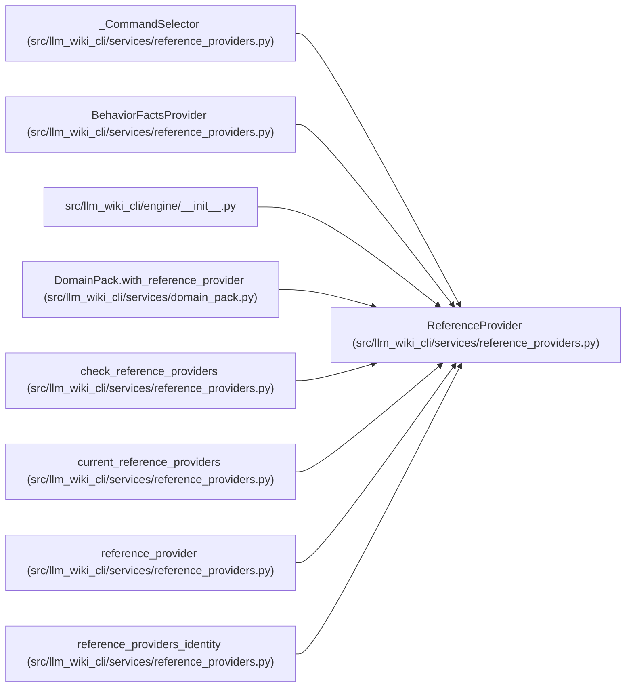

# ReferenceProvider

**Location:** `src/llm_wiki_cli/services/reference_providers.py:67`
**Kind:** Class
**Bases:** —
**Module:** [reference_providers](../modules/reference_providers.md)

## Description

The rules of one reference provider kind.

Subclasses set :attr:`kind`, choose :attr:`reads_file` and implement the
hooks. Hooks must be deterministic: publication evidence is rechecked by
running them again.

## Attributes

| Name | Type | Default | Description |
|------|------|---------|-------------|
| `kind` | `str` | `''` | — |
| `reads_file` | `bool` | `False` | — |
| `label` | `str` | `'reference'` | — |

## Methods

| Method | Signature | Decorators | Description |
|--------|-----------|------------|-------------|
| `normalize_selector` | `(dependency: Mapping[str, Any], field: str) -> dict[str, Any]` | — | The normalized form of ``dependency`` (which names the provider in ``reference``). |
| `capture` | `() -> Any` | — | The contract observed from the running installation (``reads_file`` false). |
| `parse` | `(raw: bytes) -> Any` | — | The contract read from the configured file (``reads_file`` true). |
| `validate_contract` | `(contract: Any) -> None` | — | Refuse a stored contract this provider could not have captured. |
| `select` | `(contract: Any, dependency: Mapping[str, Any]) -> str \| None` | — | A digest of the part of ``contract`` that ``dependency`` selects. |
| `identity` | `() -> Any` | — | A JSON-ready value that changes whenever this provider's results may change. |

## Relationships

<!-- Auto-generated relationship summary. Do not edit by hand. -->

### Summary

| Module | Methods | Attributes |
|---|---:|---|
| [reference_providers](../modules/reference_providers.md) | 6 | `kind`, `label`, `reads_file` |

### Structure

| Kind | Entity | Module |
|---|---|---|
| Subclass | `_CommandSelector` | [reference_providers](../modules/reference_providers.md) |
| Subclass | `BehaviorFactsProvider` | [reference_providers](../modules/reference_providers.md) |

### References

| Reference | Kind | Source | Call sites |
|---|---|---|---:|
| `__init__` | import | [engine___init__](../modules/engine___init__.md) | — |
| `DomainPack.with_reference_provider` | type_reference | [domain_pack](../modules/domain_pack.md) | — |
| `check_reference_providers` | type_reference | [reference_providers](../modules/reference_providers.md) | — |
| `current_reference_providers` | type_reference | [reference_providers](../modules/reference_providers.md) | — |
| `reference_provider` | type_reference | [reference_providers](../modules/reference_providers.md) | — |
| `reference_providers_identity` | type_reference | [reference_providers](../modules/reference_providers.md) | — |
