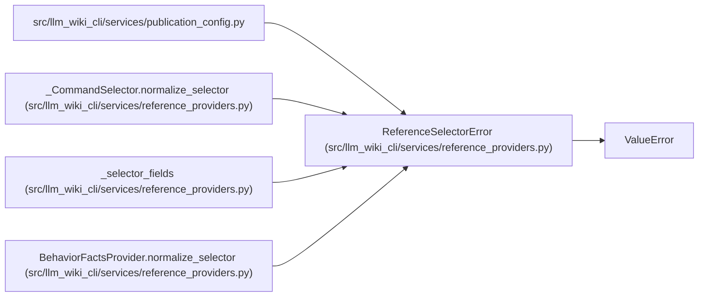

# ReferenceSelectorError

**Location:** `src/llm_wiki_cli/services/reference_providers.py:40`
**Kind:** Class
**Bases:** `ValueError`
**Module:** [reference_providers](../modules/reference_providers.md)

## Description

A topic dependency selects a reference in a way its provider refuses.

## Attributes

*No annotated attributes found.*

## Methods

| Method | Signature | Decorators | Description |
|--------|-----------|------------|-------------|
| `__init__` | `(field: str, message: str)` | — | — |

## Relationships

<!-- Auto-generated relationship summary. Do not edit by hand. -->

### Summary

| Module | Methods | Attributes |
|---|---:|---|
| [reference_providers](../modules/reference_providers.md) | 1 | — |

### Structure

| Kind | Entity | Module |
|---|---|---|
| Base | `ValueError` | — |

### References

| Reference | Kind | Source | Call sites |
|---|---|---|---:|
| `publication_config` | import | [publication_config](../modules/publication_config.md) | — |
| `_CommandSelector.normalize_selector` | call | [reference_providers](../modules/reference_providers.md) | 3 |
| `_selector_fields` | call | [reference_providers](../modules/reference_providers.md) | 2 |
| `BehaviorFactsProvider.normalize_selector` | call | [reference_providers](../modules/reference_providers.md) | 1 |
