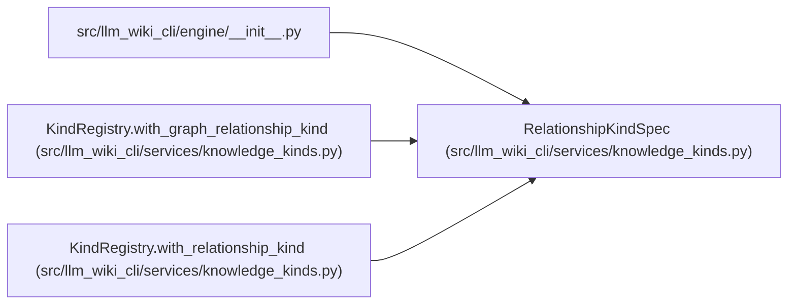

# RelationshipKindSpec

**Location:** `src/llm_wiki_cli/services/knowledge_kinds.py:92`
**Kind:** Class
**Bases:** —
**Module:** [knowledge_kinds](../modules/knowledge_kinds.md)

**Decorators:** `@dataclass(frozen=True)`

## Description

One relationship or typed-graph edge kind.

## Attributes

| Name | Type | Default | Description |
|------|------|---------|-------------|
| `name` | `str` | *required* | — |
| `description` | `str` | `''` | — |

## Methods

| Method | Signature | Decorators | Description |
|--------|-----------|------------|-------------|
| `__post_init__` | `() -> None` | — | — |

## Relationships

<!-- Auto-generated relationship summary. Do not edit by hand. -->

### Summary

| Module | Methods | Attributes |
|---|---:|---|
| [knowledge_kinds](../modules/knowledge_kinds.md) | 1 | `description`, `name` |

### References

| Reference | Kind | Source | Call sites |
|---|---|---|---:|
| `__init__` | import | [engine___init__](../modules/engine___init__.md) | — |
| `KindRegistry.with_graph_relationship_kind` | type_reference | [knowledge_kinds](../modules/knowledge_kinds.md) | — |
| `KindRegistry.with_relationship_kind` | type_reference | [knowledge_kinds](../modules/knowledge_kinds.md) | — |
