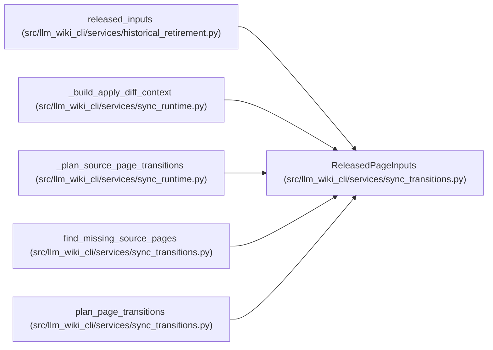

# ReleasedPageInputs

**Location:** `src/llm_wiki_cli/services/sync_transitions.py:67`
**Kind:** Class
**Bases:** —
**Module:** [sync_transitions](../modules/sync_transitions.md)

**Decorators:** `@dataclass(frozen=True)`

## Description

Evidence from this run's source capture and its validated previous native projection.

## Attributes

| Name | Type | Default | Description |
|------|------|---------|-------------|
| `source_hashes` | `Mapping[str, str]` | *required* | — |
| `page_hashes` | `Mapping[str, str]` | *required* | — |

## Methods

*No declared methods.*

## Relationships

<!-- Auto-generated relationship summary. Do not edit by hand. -->

### Summary

| Module | Methods | Attributes |
|---|---:|---|
| [sync_transitions](../modules/sync_transitions.md) | 0 | `page_hashes`, `source_hashes` |

### References

| Reference | Kind | Source | Call sites |
|---|---|---|---:|
| `released_inputs` | call | [historical_retirement](../modules/historical_retirement.md) | 1 |
| `_build_apply_diff_context` | type_reference | [sync_runtime](../modules/sync_runtime.md) | — |
| `_plan_source_page_transitions` | type_reference | [sync_runtime](../modules/sync_runtime.md) | — |
| `find_missing_source_pages` | type_reference | [sync_transitions](../modules/sync_transitions.md) | — |
| `plan_page_transitions` | type_reference | [sync_transitions](../modules/sync_transitions.md) | — |
