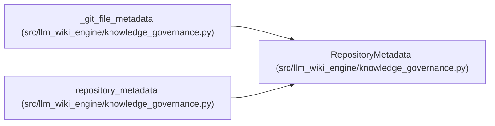

# RepositoryMetadata

**Location:** `src/llm_wiki_engine/knowledge_governance.py:3233`
**Kind:** Class
**Bases:** —
**Module:** [knowledge_governance](../modules/knowledge_governance.md)

**Decorators:** `@dataclass(frozen=True)`

## Description

Where the repository that owns one wiki keeps its Git metadata.

``kind`` is ``directory`` for an ordinary ``.git`` directory,
``linked-worktree`` for a worktree added with ``git worktree``,
``separate-git-dir`` for a submodule or another checkout whose Git
directory lives elsewhere, ``unverified`` when the nearest ``.git`` entry
cannot be tied to this checkout, and ``none`` outside Git.

``git_dir`` holds the metadata of this one checkout and ``common_dir`` the
metadata shared by all worktrees of the repository. Both are ``None`` for
``unverified`` and ``none``.

## Attributes

| Name | Type | Default | Description |
|------|------|---------|-------------|
| `kind` | `str` | *required* | — |
| `worktree_root` | `Path \| None` | `None` | — |
| `git_dir` | `Path \| None` | `None` | — |
| `common_dir` | `Path \| None` | `None` | — |

## Methods

*No declared methods.*

## Relationships

<!-- Auto-generated relationship summary. Do not edit by hand. -->

### Summary

| Module | Methods | Attributes |
|---|---:|---|
| [knowledge_governance](../modules/knowledge_governance.md) | 0 | `common_dir`, `git_dir`, `kind`, `worktree_root` |

### References

| Reference | Kind | Source | Call sites |
|---|---|---|---:|
| `_git_file_metadata` | call | [knowledge_governance](../modules/knowledge_governance.md) | 2 |
| `_git_file_metadata` | type_reference | [knowledge_governance](../modules/knowledge_governance.md) | — |
| `repository_metadata` | call | [knowledge_governance](../modules/knowledge_governance.md) | 4 |
| `repository_metadata` | type_reference | [knowledge_governance](../modules/knowledge_governance.md) | — |
