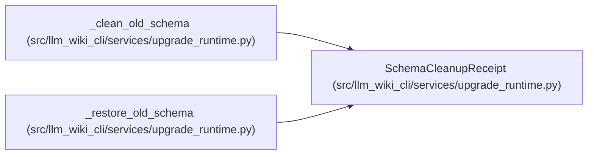

# SchemaCleanupReceipt

**Location:** `src/llm_wiki_cli/services/upgrade_runtime.py:105`
**Kind:** Class
**Bases:** —
**Module:** [upgrade_runtime](../modules/upgrade_runtime.md)

**Decorators:** `@dataclass(frozen=True)`

## Description

Reversible source-schema mutation held until cleanup is committed.

## Attributes

| Name | Type | Default | Description |
|------|------|---------|-------------|
| `path` | `Path` | *required* | — |
| `before` | `bytes` | *required* | — |
| `after` | `bytes \| None` | *required* | — |

## Methods

*No declared methods.*

## Relationships

<!-- Auto-generated relationship summary. Do not edit by hand. -->

### Summary

| Module | Methods | Attributes |
|---|---:|---|
| [upgrade_runtime](../modules/upgrade_runtime.md) | 0 | `after`, `before`, `path` |

### References

| Reference | Kind | Source | Call sites |
|---|---|---|---:|
| `_clean_old_schema` | call | [upgrade_runtime](../modules/upgrade_runtime.md) | 2 |
| `_clean_old_schema` | type_reference | [upgrade_runtime](../modules/upgrade_runtime.md) | — |
| `_restore_old_schema` | type_reference | [upgrade_runtime](../modules/upgrade_runtime.md) | — |
