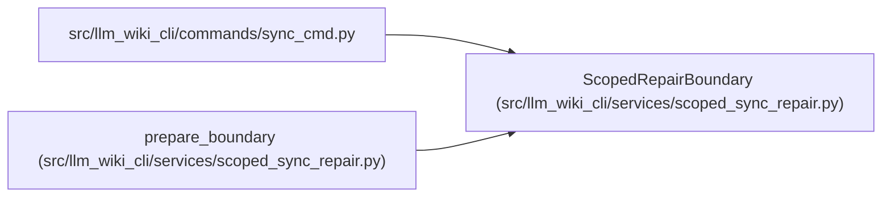

# ScopedRepairBoundary

**Location:** `src/llm_wiki_cli/services/scoped_sync_repair.py:137`
**Kind:** Class
**Bases:** —
**Module:** [scoped_sync_repair](../modules/scoped_sync_repair.md)

**Decorators:** `@dataclass(frozen=True)`

## Description

Captures complete committed authority, source/selection and wiki inputs, exact Markdown hashes, the checked current producer and installed-package identity. The candidate may refresh selected module/entity evidence, derived references, the log and declared transaction metadata. Its producer must canonically match the actual current analysis, while opaque producer annotations stay protected.

Unselected structural baselines, pages, relationships and graph facts remain unchanged. Identical executable observations may rebind only to the current captured issuer; source, syntax, prose, coordinates and availability remain exact. Ordinary review can become pending on an issuer change, with acknowledgement, coordinate and target histories preserved. No review is acknowledged by repair.

The boundary rechecks provider/helper/runtime and source inputs at publication checkpoints. The existing adopted writer supplies wiki-byte custody and full recovery preimages; the boundary does not replace recovery or invent ownership.

## Attributes

| Name | Type | Default | Description |
|------|------|---------|-------------|
| `options` | `Any` | *required* | — |
| `prepared_inputs` | `Any` | *required* | — |
| `paths` | `frozenset[str]` | *required* | — |
| `pages` | `frozenset[str]` | *required* | — |
| `wiki_hashes` | `tuple[str, str]` | *required* | — |
| `producer` | `Any` | *required* | — |
| `markdown_hashes` | `dict[str, str]` | *required* | — |
| `package_hash` | `str` | *required* | — |

## Methods

| Method | Signature | Decorators | Description |
|--------|-----------|------------|-------------|
| `assert_current` | `() -> None` | — | — |
| `assert_analysis_current` | `() -> None` | — | — |
| `validate_markdown` | `(root) -> None` | — | — |
| `validate_plan` | `(plan: KnowledgeCommitPlan) -> None` | — | Verify the full candidate, including globals, before root publication. |

## Relationships

<!-- Auto-generated relationship summary. Do not edit by hand. -->

### Summary

| Module | Methods | Attributes |
|---|---:|---|
| [scoped_sync_repair](../modules/scoped_sync_repair.md) | 4 | `markdown_hashes`, `options`, `package_hash`, `pages`, `paths`, `prepared_inputs`, `producer`, `wiki_hashes` |

### References

| Reference | Kind | Source | Call sites |
|---|---|---|---:|
| `sync_cmd` | import | [sync_cmd](../modules/sync_cmd.md) | — |
| `prepare_boundary` | call | [scoped_sync_repair](../modules/scoped_sync_repair.md) | 1 |
| `prepare_boundary` | type_reference | [scoped_sync_repair](../modules/scoped_sync_repair.md) | — |
