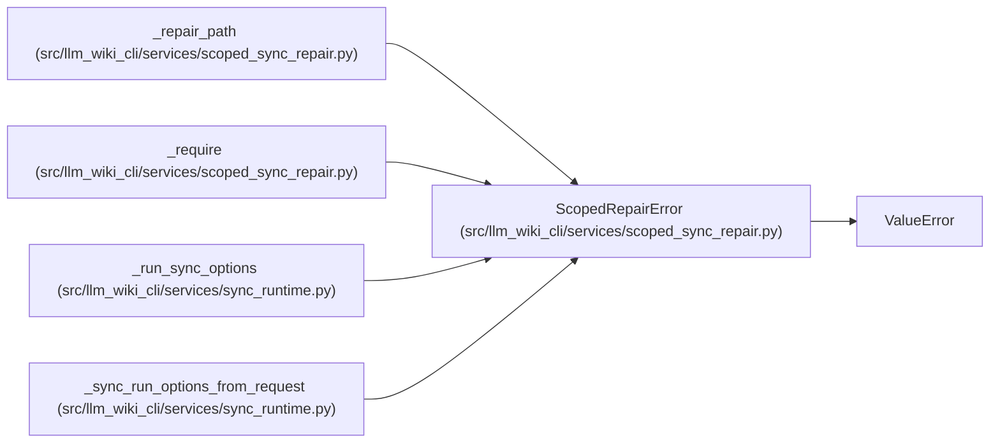

# ScopedRepairError

**Location:** `src/llm_wiki_cli/services/scoped_sync_repair.py:22`
**Kind:** Class
**Bases:** `ValueError`
**Module:** [scoped_sync_repair](../modules/scoped_sync_repair.md)

## Description

The requested repair cannot preserve its declared scope.

## Attributes

*No annotated attributes found.*

## Methods

*No declared methods.*

## Relationships

<!-- Auto-generated relationship summary. Do not edit by hand. -->

### Summary

| Module | Methods | Attributes |
|---|---:|---|
| [scoped_sync_repair](../modules/scoped_sync_repair.md) | 0 | — |

### Structure

| Kind | Entity | Module |
|---|---|---|
| Base | `ValueError` | — |

### References

| Reference | Kind | Source | Call sites |
|---|---|---|---:|
| `_repair_path` | call | [scoped_sync_repair](../modules/scoped_sync_repair.md) | 1 |
| `_require` | call | [scoped_sync_repair](../modules/scoped_sync_repair.md) | 1 |
| `_run_sync_options` | call | [sync_runtime](../modules/sync_runtime.md) | 3 |
| `_sync_run_options_from_request` | call | [sync_runtime](../modules/sync_runtime.md) | 2 |
