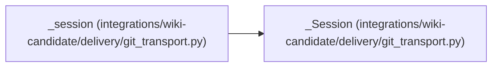

# _Session

**Location:** `integrations/wiki-candidate/delivery/git_transport.py:353`
**Kind:** Class
**Bases:** —
**Module:** [git_transport](../modules/git_transport.md)

**Decorators:** `@dataclass`

## Description

_Auto-generated from `_Session` in `integrations/wiki-candidate/delivery/git_transport.py`._

## Attributes

| Name | Type | Default | Description |
|------|------|---------|-------------|
| `root` | `Path` | *required* | — |
| `source` | `_Remote` | *required* | — |
| `target` | `_Remote` | *required* | — |
| `repo` | `Path` | *required* | — |
| `source_ref` | `str \| None` | *required* | — |
| `source_line` | `str` | *required* | — |
| `source_sha` | `str` | *required* | — |
| `branch_choice` | `str \| None` | *required* | — |
| `branch` | `str` | *required* | — |
| `head` | `str` | *required* | — |

## Methods

| Method | Signature | Decorators | Description |
|--------|-----------|------------|-------------|
| `verify_source` | `()` | — | — |
| `verify_target` | `(expected)` | — | — |
| `check_high_water` | `(checkpoint)` | — | — |
| `readback` | `(revision, expected_tree, desired)` | — | — |

## Relationships

<!-- Auto-generated relationship summary. Do not edit by hand. -->

### Summary

| Module | Methods | Attributes |
|---|---:|---|
| [git_transport](../modules/git_transport.md) | 4 | `branch`, `branch_choice`, `head`, `repo`, `root`, `source`, `source_line`, `source_ref`, `source_sha`, `target` |

### References

| Reference | Kind | Source | Call sites |
|---|---|---|---:|
| `_session` | call | [git_transport](../modules/git_transport.md) | 1 |
