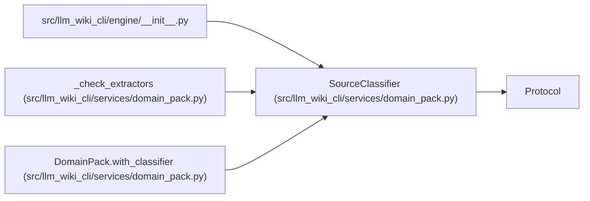

# SourceClassifier

**Location:** `src/llm_wiki_cli/services/domain_pack.py:79`
**Kind:** Class
**Bases:** `Protocol`
**Module:** [domain_pack](../modules/domain_pack.md)

**Decorators:** `@runtime_checkable`

## Description

Decides which files are sources and of which kind.

## Attributes

*No annotated attributes found.*

## Methods

| Method | Signature | Decorators | Description |
|--------|-----------|------------|-------------|
| `source_kinds` | `() -> Mapping[str, tuple[str, ...]]` | — | Every source kind this classifier can return, with its suffixes. |
| `classify` | `(path: PurePath, include_tests: frozenset[str]) -> tuple[str \| None, str \| None]` | — | Return ``(kind, exclusion)`` for a repository-relative path. |
| `inventory_language` | `(path: str) -> str \| None` | — | The ``language`` label an inventory records for ``path``. |

## Relationships

<!-- Auto-generated relationship summary. Do not edit by hand. -->

### Summary

| Module | Methods | Attributes |
|---|---:|---|
| [domain_pack](../modules/domain_pack.md) | 3 | — |

### Structure

| Kind | Entity | Module |
|---|---|---|
| Base | `Protocol` | — |

### References

| Reference | Kind | Source | Call sites |
|---|---|---|---:|
| `__init__` | import | [engine___init__](../modules/engine___init__.md) | — |
| `_check_extractors` | type_reference | [domain_pack](../modules/domain_pack.md) | — |
| `DomainPack.with_classifier` | type_reference | [domain_pack](../modules/domain_pack.md) | — |
