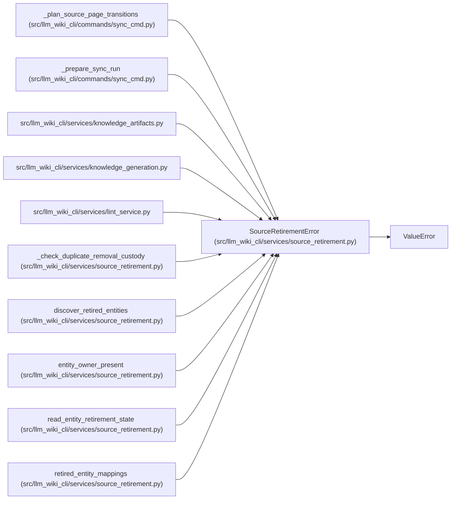

# SourceRetirementError

**Location:** `src/llm_wiki_cli/services/source_retirement.py:23`
**Kind:** Class
**Bases:** `ValueError`
**Module:** [source_retirement](../modules/source_retirement.md)

## Description

A retirement record cannot be reconciled with authoritative ownership.

## Attributes

*No annotated attributes found.*

## Methods

*No public methods. Inherits from base classes.*

## Relationships

<!-- Auto-generated relationship summary. Do not edit by hand. -->

### Summary

| Module | Methods | Attributes |
|---|---:|---|
| [source_retirement](../modules/source_retirement.md) | 0 | — |

### Structure

| Kind | Entity | Module |
|---|---|---|
| Base | `ValueError` | — |

### References

| Reference | Kind | Source | Call sites |
|---|---|---|---:|
| `_plan_source_page_transitions` | call | [sync_cmd](../modules/sync_cmd.md) | 1 |
| `_prepare_sync_run` | call | [sync_cmd](../modules/sync_cmd.md) | 1 |
| `knowledge_artifacts` | import | [knowledge_artifacts](../modules/knowledge_artifacts.md) | — |
| `knowledge_generation` | import | [knowledge_generation](../modules/knowledge_generation.md) | — |
| `lint_service` | import | [lint_service](../modules/lint_service.md) | — |
| `_check_duplicate_removal_custody` | call | [source_retirement](../modules/source_retirement.md) | 2 |
| `discover_retired_entities` | call | [source_retirement](../modules/source_retirement.md) | 4 |
| `entity_owner_present` | call | [source_retirement](../modules/source_retirement.md) | 1 |
| `read_entity_retirement_state` | call | [source_retirement](../modules/source_retirement.md) | 9 |
| `retired_entity_mappings` | call | [source_retirement](../modules/source_retirement.md) | 1 |
