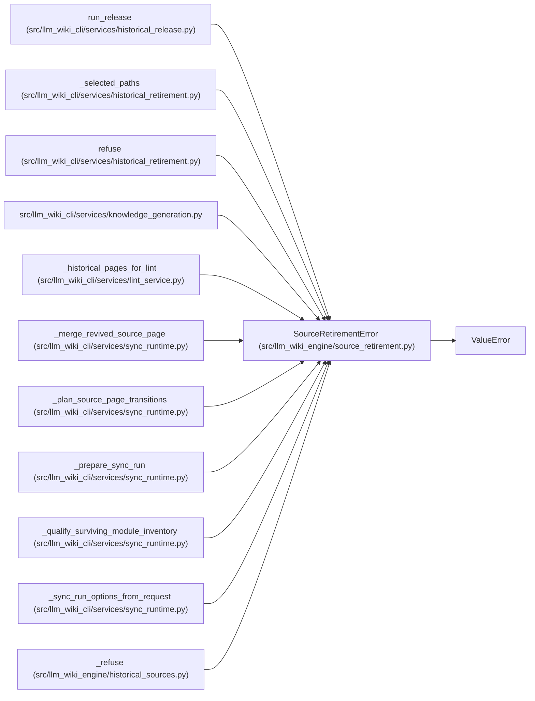

# SourceRetirementError

**Location:** `src/llm_wiki_engine/source_retirement.py:29`
**Kind:** Class
**Bases:** `ValueError`
**Module:** [source_retirement](../modules/source_retirement.md)

## Description

A retirement record cannot be reconciled with authoritative ownership.

## Attributes

*No annotated attributes found.*

## Methods

*No declared methods.*

## Relationships

<!-- Auto-generated relationship summary. Do not edit by hand. -->

### Summary

| Module | Methods | Attributes |
|---|---:|---|
| [source_retirement](../modules/source_retirement.md) | 0 | — |

### Structure

| Kind | Entity | Module |
|---|---|---|
| Base | `ValueError` | — |

### References

| Reference | Kind | Source | Call sites |
|---|---|---|---:|
| `run_release` | call | [historical_release](../modules/historical_release.md) | 6 |
| `_selected_paths` | call | [historical_retirement](../modules/historical_retirement.md) | 1 |
| `refuse` | call | [historical_retirement](../modules/historical_retirement.md) | 1 |
| `knowledge_generation` | import | [knowledge_generation](../modules/knowledge_generation.md) | — |
| `_historical_pages_for_lint` | call | [lint_service](../modules/lint_service.md) | 1 |
| `_merge_revived_source_page` | call | [sync_runtime](../modules/sync_runtime.md) | 1 |
| `_plan_source_page_transitions` | call | [sync_runtime](../modules/sync_runtime.md) | 1 |
| `_prepare_sync_run` | call | [sync_runtime](../modules/sync_runtime.md) | 2 |
| `_qualify_surviving_module_inventory` | call | [sync_runtime](../modules/sync_runtime.md) | 1 |
| `_sync_run_options_from_request` | call | [sync_runtime](../modules/sync_runtime.md) | 3 |
| `_refuse` | call | [historical_sources](../modules/historical_sources.md) | 1 |
| `_refuse` | type_reference | [historical_sources](../modules/historical_sources.md) | — |

> References: showing 12 of 20 logical references; 8 omitted by the 12-row generated summary limit.
