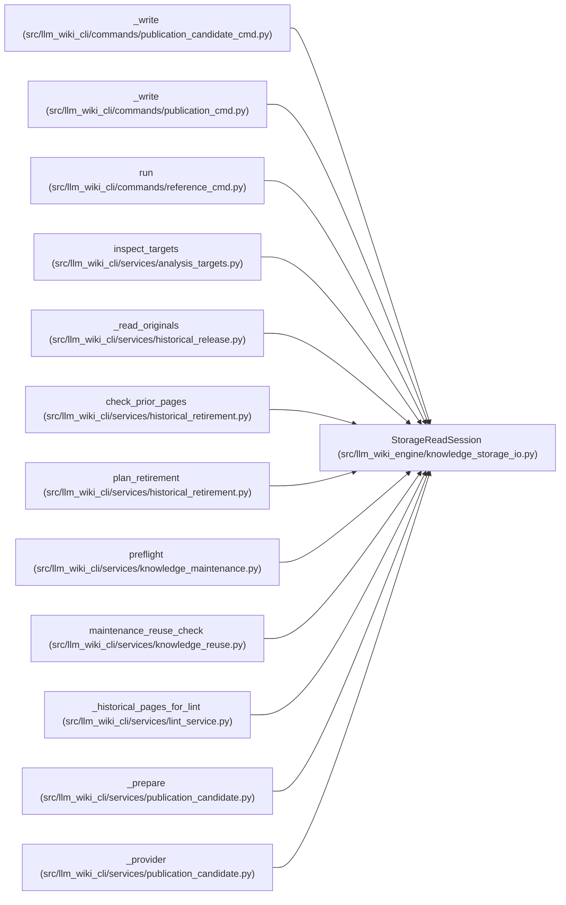

# StorageReadSession

**Location:** `src/llm_wiki_engine/knowledge_storage_io.py:313`
**Kind:** Class
**Bases:** —
**Module:** [knowledge_storage_io](../modules/knowledge_storage_io.md)

## Description

Retains request-owned observations of complete files and pack ranges. It counts actual bytes and read operations, enforces a cumulative budget and rejects inconsistent file identities across members of a pack. Final rechecks reread the consumed bytes through the same guarded filesystem owner; cache reuse never substitutes for this validation.

## Attributes

*No annotated attributes found.*

## Methods

| Method | Signature | Decorators | Description |
|--------|-----------|------------|-------------|
| `__init__` | `(wiki_dir: str \| Path, *, max_bytes: int = MAX_EXPANDED_BYTES, max_handles: int = 128, cancelled = None, coalesce_rechecks: bool = False)` | — | — |
| `phase` | `()` | `@contextmanager` | Keep observations provisional until successful phase validation and release. |
| `_read_guarded` | `(*args, **kwargs)` | — | — |
| `read` | `(relative: str, maximum: int) -> bytes` | — | — |
| `recheck` | `() -> None` | — | — |
| `read_range` | `(relative: str, offset: int, length: int, file_bytes: int) -> bytes` | — | Read and retain an authenticated member range, without reading its whole pack. |
| `_remember_range` | `(key, observed)` | — | — |
| `read_ranges` | `(ranges)` | — | Coalesce exact neighbours only: zero speculative or uncharged bytes. |
| `recheck_work` | `()` | — | — |
| `receipt` | `() -> dict[str, Any]` | — | — |

## Relationships

<!-- Auto-generated relationship summary. Do not edit by hand. -->

### Summary

| Module | Methods | Attributes |
|---|---:|---|
| [knowledge_storage_io](../modules/knowledge_storage_io.md) | 10 | — |

### References

| Reference | Kind | Source | Call sites |
|---|---|---|---:|
| `_write` | call | [publication_candidate_cmd](../modules/publication_candidate_cmd.md) | 1 |
| `_write` | call | [publication_cmd](../modules/publication_cmd.md) | 1 |
| `run` | call | [reference_cmd](../modules/reference_cmd.md) | 1 |
| `inspect_targets` | call | [analysis_targets](../modules/analysis_targets.md) | 1 |
| `_read_originals` | call | [historical_release](../modules/historical_release.md) | 1 |
| `check_prior_pages` | call | [historical_retirement](../modules/historical_retirement.md) | 1 |
| `plan_retirement` | call | [historical_retirement](../modules/historical_retirement.md) | 1 |
| `preflight` | call | [knowledge_maintenance](../modules/knowledge_maintenance.md) | 1 |
| `maintenance_reuse_check` | call | [knowledge_reuse](../modules/knowledge_reuse.md) | 1 |
| `_historical_pages_for_lint` | call | [lint_service](../modules/lint_service.md) | 1 |
| `_prepare` | call | [publication_candidate](../modules/publication_candidate.md) | 1 |
| `_provider` | call | [publication_candidate](../modules/publication_candidate.md) | 2 |

> References: showing 12 of 37 logical references; 25 omitted by the 12-row generated summary limit.
