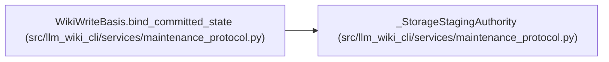

# _StorageStagingAuthority

**Location:** `src/llm_wiki_cli/services/maintenance_protocol.py:178`
**Kind:** Class
**Bases:** —
**Module:** [maintenance_protocol](../modules/maintenance_protocol.md)

**Decorators:** `@dataclass(frozen=True)`

## Description

_Auto-generated from `_StorageStagingAuthority` in `src/llm_wiki_cli/services/maintenance_protocol.py`._

## Attributes

| Name | Type | Default | Description |
|------|------|---------|-------------|
| `basis` | `object` | *required* | — |
| `state` | `CommittedKnowledgeState` | *required* | — |
| `source_snapshot` | `SourceSnapshot` | *required* | — |
| `_issued` | `object \| None` | `field(default=None, init=False, repr=False)` | — |
| `_active` | `bool` | `field(default=True, init=False, repr=False)` | — |

## Methods

*No declared methods.*

## Relationships

<!-- Auto-generated relationship summary. Do not edit by hand. -->

### Summary

| Module | Methods | Attributes |
|---|---:|---|
| [maintenance_protocol](../modules/maintenance_protocol.md) | 0 | `_active`, `_issued`, `basis`, `source_snapshot`, `state` |

### References

| Reference | Kind | Source | Call sites |
|---|---|---|---:|
| `WikiWriteBasis.bind_committed_state` | call | [maintenance_protocol](../modules/maintenance_protocol.md) | 1 |
