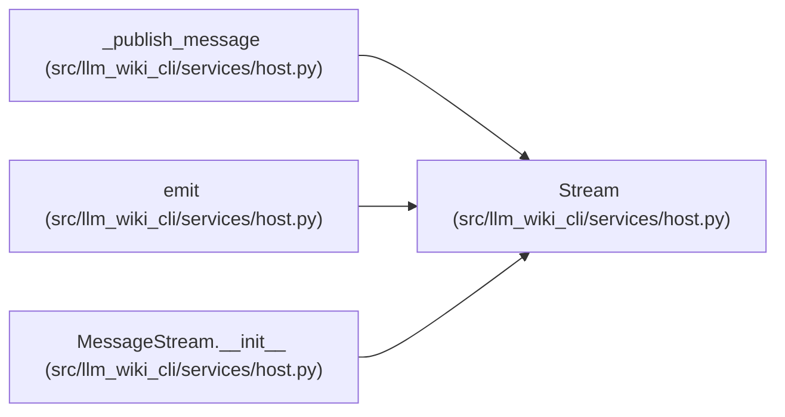

# Stream

**Location:** `src/llm_wiki_cli/services/host.py:181`
**Kind:** Type alias
**Bases:** —
**Module:** [host](../modules/host.md)
**Target:** `Literal['stdout', 'stderr']`

## Description

_Auto-generated from `Stream` in `src/llm_wiki_cli/services/host.py`._

## Attributes

*See the alias definition for its member types.*

## Methods

*See the alias definition for callable and member types.*

## Relationships

<!-- Auto-generated relationship summary. Do not edit by hand. -->

### Summary

| Module | Methods | Attributes |
|---|---:|---|
| [host](../modules/host.md) | 0 | — |

### References

| Reference | Kind | Source | Call sites |
|---|---|---|---:|
| `_publish_message` | type_reference | [host](../modules/host.md) | — |
| `emit` | type_reference | [host](../modules/host.md) | — |
| `MessageStream.__init__` | type_reference | [host](../modules/host.md) | — |
