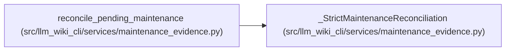

# _StrictMaintenanceReconciliation

**Location:** `src/llm_wiki_cli/services/maintenance_evidence.py:548`
**Kind:** Class
**Bases:** —
**Module:** [maintenance_evidence](../modules/maintenance_evidence.md)

## Description

_Auto-generated from `_StrictMaintenanceReconciliation` in `src/llm_wiki_cli/services/maintenance_evidence.py`._

## Attributes

*No annotated attributes found.*

## Methods

| Method | Signature | Decorators | Description |
|--------|-----------|------------|-------------|
| `__init__` | `(previous_state, core)` | — | — |
| `_apply_owned` | `(state, event, current_basis)` | — | — |
| `_event_owned` | `(state, record_id, kind, **fields)` | — | — |
| `finish` | `()` | — | — |

## Relationships

<!-- Auto-generated relationship summary. Do not edit by hand. -->

### Summary

| Module | Methods | Attributes |
|---|---:|---|
| [maintenance_evidence](../modules/maintenance_evidence.md) | 4 | — |

### References

| Reference | Kind | Source | Call sites |
|---|---|---|---:|
| `reconcile_pending_maintenance` | call | [maintenance_evidence](../modules/maintenance_evidence.md) | 1 |
