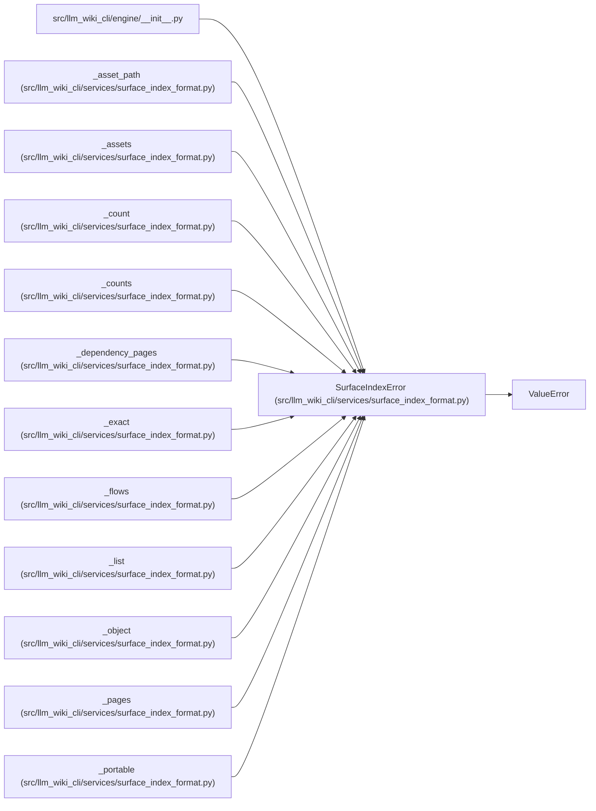

# SurfaceIndexError

**Location:** `src/llm_wiki_cli/services/surface_index_format.py:58`
**Kind:** Class
**Bases:** `ValueError`
**Module:** [surface_index_format](../modules/surface_index_format.md)

## Description

A surface index does not follow its format.

## Attributes

*No annotated attributes found.*

## Methods

*No declared methods.*

## Relationships

<!-- Auto-generated relationship summary. Do not edit by hand. -->

### Summary

| Module | Methods | Attributes |
|---|---:|---|
| [surface_index_format](../modules/surface_index_format.md) | 0 | — |

### Structure

| Kind | Entity | Module |
|---|---|---|
| Base | `ValueError` | — |

### References

| Reference | Kind | Source | Call sites |
|---|---|---|---:|
| `__init__` | import | [engine___init__](../modules/engine___init__.md) | — |
| `_asset_path` | call | [surface_index_format](../modules/surface_index_format.md) | 1 |
| `_assets` | call | [surface_index_format](../modules/surface_index_format.md) | 6 |
| `_count` | call | [surface_index_format](../modules/surface_index_format.md) | 1 |
| `_counts` | call | [surface_index_format](../modules/surface_index_format.md) | 5 |
| `_dependency_pages` | call | [surface_index_format](../modules/surface_index_format.md) | 2 |
| `_exact` | call | [surface_index_format](../modules/surface_index_format.md) | 2 |
| `_flows` | call | [surface_index_format](../modules/surface_index_format.md) | 4 |
| `_list` | call | [surface_index_format](../modules/surface_index_format.md) | 1 |
| `_object` | call | [surface_index_format](../modules/surface_index_format.md) | 1 |
| `_pages` | call | [surface_index_format](../modules/surface_index_format.md) | 10 |
| `_portable` | call | [surface_index_format](../modules/surface_index_format.md) | 1 |

> References: showing 12 of 15 logical references; 3 omitted by the 12-row generated summary limit.
