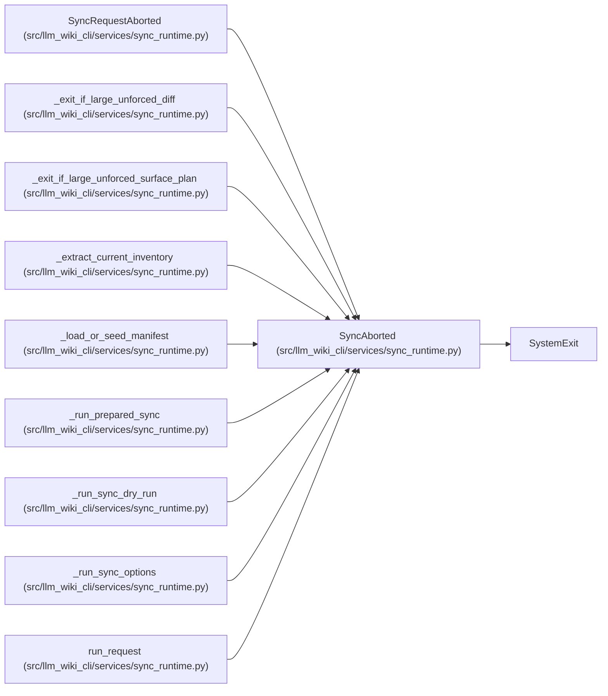

# SyncAborted

**Location:** `src/llm_wiki_cli/services/sync_runtime.py:264`
**Kind:** Class
**Bases:** `SystemExit`
**Module:** [sync_runtime](../modules/sync_runtime.md)

## Description

Sync stopped after writing why to the host's stderr.

``code`` is the CLI exit status. It derives from ``SystemExit`` so that
every cleanup path between the stop and the command boundary behaves as it
did when the command exited; :func:`execute_sync` turns it into
:class:`SyncError`.

## Attributes

*No annotated attributes found.*

## Methods

*No declared methods.*

## Relationships

<!-- Auto-generated relationship summary. Do not edit by hand. -->

### Summary

| Module | Methods | Attributes |
|---|---:|---|
| [sync_runtime](../modules/sync_runtime.md) | 0 | — |

### Structure

| Kind | Entity | Module |
|---|---|---|
| Base | `SystemExit` | — |
| Subclass | `SyncRequestAborted` | [sync_runtime](../modules/sync_runtime.md) |

### References

| Reference | Kind | Source | Call sites |
|---|---|---|---:|
| `_exit_if_large_unforced_diff` | call | [sync_runtime](../modules/sync_runtime.md) | 1 |
| `_exit_if_large_unforced_surface_plan` | call | [sync_runtime](../modules/sync_runtime.md) | 1 |
| `_extract_current_inventory` | call | [sync_runtime](../modules/sync_runtime.md) | 1 |
| `_load_or_seed_manifest` | call | [sync_runtime](../modules/sync_runtime.md) | 1 |
| `_run_prepared_sync` | call | [sync_runtime](../modules/sync_runtime.md) | 1 |
| `_run_sync_dry_run` | call | [sync_runtime](../modules/sync_runtime.md) | 1 |
| `_run_sync_options` | call | [sync_runtime](../modules/sync_runtime.md) | 1 |
| `run_request` | call | [sync_runtime](../modules/sync_runtime.md) | 1 |
