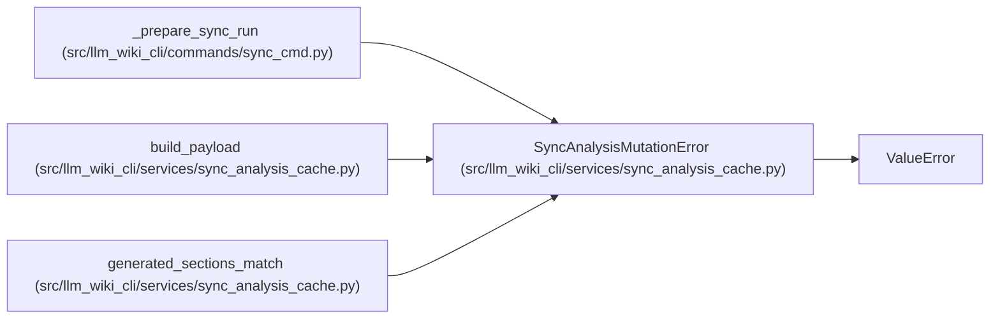

# SyncAnalysisMutationError

**Location:** `src/llm_wiki_cli/services/sync_analysis_cache.py:25`
**Kind:** Class
**Bases:** `ValueError`
**Module:** [sync_analysis_cache](../modules/sync_analysis_cache.md)

## Description

A matched static-input snapshot changed before publication.

## Attributes

*No annotated attributes found.*

## Methods

*No declared methods.*

## Relationships

<!-- Auto-generated relationship summary. Do not edit by hand. -->

### Summary

| Module | Methods | Attributes |
|---|---:|---|
| [sync_analysis_cache](../modules/sync_analysis_cache.md) | 0 | — |

### Structure

| Kind | Entity | Module |
|---|---|---|
| Base | `ValueError` | — |

### References

| Reference | Kind | Source | Call sites |
|---|---|---|---:|
| `_prepare_sync_run` | call | [sync_cmd](../modules/sync_cmd.md) | 3 |
| `build_payload` | call | [sync_analysis_cache](../modules/sync_analysis_cache.md) | 1 |
| `generated_sections_match` | call | [sync_analysis_cache](../modules/sync_analysis_cache.md) | 1 |
