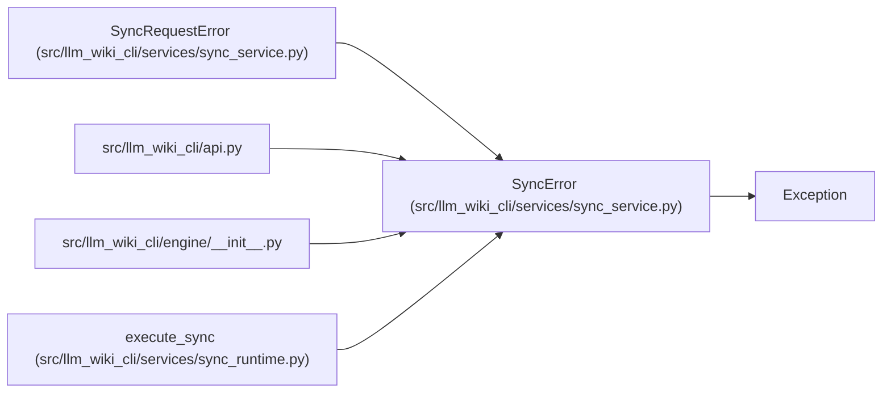

# SyncError

**Location:** `src/llm_wiki_cli/services/sync_service.py:85`
**Kind:** Class
**Bases:** `Exception`
**Module:** [sync_service](../modules/sync_service.md)

## Description

Sync stopped; ``exit_code`` is the status the CLI would exit with.

## Attributes

*No annotated attributes found.*

## Methods

| Method | Signature | Decorators | Description |
|--------|-----------|------------|-------------|
| `__init__` | `(message: str, *, exit_code: int) -> None` | — | — |

## Relationships

<!-- Auto-generated relationship summary. Do not edit by hand. -->

### Summary

| Module | Methods | Attributes |
|---|---:|---|
| [sync_service](../modules/sync_service.md) | 1 | — |

### Structure

| Kind | Entity | Module |
|---|---|---|
| Base | `Exception` | — |
| Subclass | `SyncRequestError` | [sync_service](../modules/sync_service.md) |

### References

| Reference | Kind | Source | Call sites |
|---|---|---|---:|
| `api` | import | [api](../modules/api.md) | — |
| `__init__` | import | [engine___init__](../modules/engine___init__.md) | — |
| `execute_sync` | call | [sync_runtime](../modules/sync_runtime.md) | 1 |
