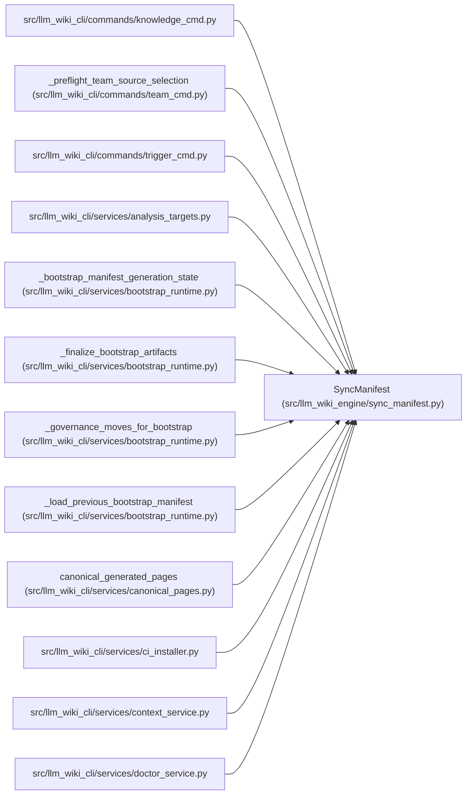

# SyncManifest

**Location:** `src/llm_wiki_engine/sync_manifest.py:893`
**Kind:** Class
**Bases:** —
**Module:** [sync_manifest](../modules/sync_manifest.md)

**Decorators:** `@dataclass`

## Description

Operational state; maintenance is present only after explicit adoption.

## Attributes

| Name | Type | Default | Description |
|------|------|---------|-------------|
| `sources` | `dict[str, dict]` | `field(default_factory=dict)` | — |
| `surfaces` | `dict[str, dict]` | `field(default_factory=dict)` | — |
| `generation_inputs` | `dict[str, object]` | `field(default_factory=dict)` | — |
| `page_source_mappings` | `dict[str, ManifestPageSource]` | `field(default_factory=dict)` | — |
| `evidence_baselines` | `dict[str, ManifestEvidenceBaseline]` | `field(default_factory=dict)` | — |
| `tombstones` | `dict[str, ManifestTombstone]` | `field(default_factory=dict)` | — |
| `artifact_hashes` | `ManifestArtifactHashes \| None` | `None` | — |
| `storage_version` | `int` | `field(default=5, repr=False, compare=False)` | — |
| `storage_objects` | `dict[str, bytes]` | `field(default_factory=dict, repr=False, compare=False)` | — |
| `maintenance_state` | `dict[str, Any] \| None` | `field(default=None, repr=False)` | — |

## Methods

| Method | Signature | Decorators | Description |
|--------|-----------|------------|-------------|
| `from_payload` | `(value: object, *, object_reader = None) -> SyncManifest` | `@classmethod` | Validate and migrate one decoded manifest payload. |
| `load` | `(wiki_dir: Path) -> SyncManifest` | `@classmethod` | Load a manifest; raise ``FileNotFoundError`` when it is absent. |
| `_validate_operational_state` | `() -> None` | — | — |
| `_validate_basis_mapping` | `(basis: ConceptObservationBasis \| None, mapping: ManifestPageSource, field_name: str) -> None` | `@staticmethod` | — |
| `to_payload` | `() -> dict[str, object]` | — | Emit legacy v5 or explicitly adopted maintenance v7 deterministically. |
| `to_json` | `() -> str` | — | Return deterministic UTF-8-ready JSON with one trailing newline. |
| `save` | `(wiki_dir: Path) -> None` | — | Atomically write the manifest through the shared JSON boundary. |
| `with_artifact_hashes` | `(*, surface_index_hash: str, knowledge_index_hash: str, evaluated_envelope_hash: str, governance_hash: str \| None = None, maintenance_adoption_hash: str \| None = None) -> SyncManifest` | — | Return a copy carrying one complete artifact-set commitment. |
| `without_artifact_hashes` | `() -> SyncManifest` | — | Return a copy with no artifact-set commitment. |
| `with_maintenance_state` | `(value: Mapping[str, Any]) -> SyncManifest` | — | Replace explicit authority, invalidating projections until publication. |
| `with_generation_state` | `(*, surfaces: Mapping[str, Mapping], generation_inputs: Mapping[str, object]) -> SyncManifest` | — | Replace generation policy while invalidating any prior commitment. |
| `build_from_inventory` | `(inventory: dict, src_dir: str, entity_page_cache: dict[tuple[str, str], str], module_page_map: dict[str, str], *, entity_occurrence_page_cache: dict[tuple[str, str, int], str] \| None = None, surfaces: Mapping[str, Mapping] \| None = None, generation_inputs: Mapping[str, object] \| None = None, previous_manifest: SyncManifest \| None = None, evidence_baselines: Mapping[str, ConceptObservationBasis \| ManifestEvidenceBaseline] \| None = None, source_content_hashes: Mapping[str, str] \| None = None, retained_page_paths: Iterable[str] \| None = None, unknown_evidence_reason: str = EVIDENCE_NOT_RECORDED) -> SyncManifest` | `@classmethod` | Build current state and reconcile retained prior page evidence. |

## Relationships

<!-- Auto-generated relationship summary. Do not edit by hand. -->

### Summary

| Module | Methods | Attributes |
|---|---:|---|
| [sync_manifest](../modules/sync_manifest.md) | 12 | `artifact_hashes`, `evidence_baselines`, `generation_inputs`, `maintenance_state`, `page_source_mappings`, `sources`, `storage_objects`, `storage_version`, `surfaces`, `tombstones` |

### References

| Reference | Kind | Source | Call sites |
|---|---|---|---:|
| `knowledge_cmd` | import | [knowledge_cmd](../modules/knowledge_cmd.md) | — |
| `_preflight_team_source_selection` | type_reference | [team_cmd](../modules/team_cmd.md) | — |
| `trigger_cmd` | import | [trigger_cmd](../modules/trigger_cmd.md) | — |
| `analysis_targets` | import | [analysis_targets](../modules/analysis_targets.md) | — |
| `_bootstrap_manifest_generation_state` | type_reference | [bootstrap_runtime](../modules/bootstrap_runtime.md) | — |
| `_finalize_bootstrap_artifacts` | type_reference | [bootstrap_runtime](../modules/bootstrap_runtime.md) | — |
| `_governance_moves_for_bootstrap` | type_reference | [bootstrap_runtime](../modules/bootstrap_runtime.md) | — |
| `_load_previous_bootstrap_manifest` | type_reference | [bootstrap_runtime](../modules/bootstrap_runtime.md) | — |
| `canonical_generated_pages` | type_reference | [canonical_pages](../modules/canonical_pages.md) | — |
| `ci_installer` | import | [ci_installer](../modules/ci_installer.md) | — |
| `context_service` | import | [context_service](../modules/context_service.md) | — |
| `doctor_service` | import | [doctor_service](../modules/doctor_service.md) | — |

> References: showing 12 of 120 logical references; 108 omitted by the 12-row generated summary limit.
