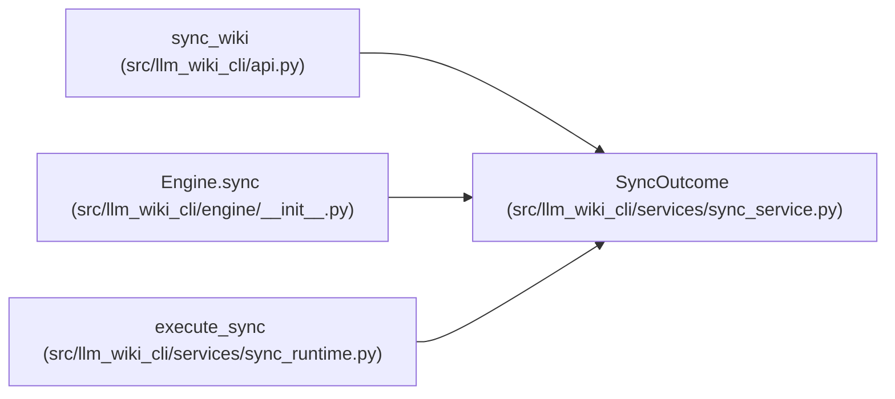

# SyncOutcome

**Location:** `src/llm_wiki_cli/services/sync_service.py:59`
**Kind:** Class
**Bases:** —
**Module:** [sync_service](../modules/sync_service.md)

**Decorators:** `@dataclass(frozen=True)`

## Description

What one sync did; human-readable progress went to the host streams.

## Attributes

| Name | Type | Default | Description |
|------|------|---------|-------------|
| `status` | `SyncStatus` | *required* | — |
| `dry_run` | `bool` | *required* | — |
| `pages` | `Mapping[str, int]` | `field(default_factory=dict)` | — |
| `regenerated_evidence_pages` | `tuple[str, ...]` | `()` | — |
| `storage_cleanup` | `Mapping[str, Any] \| None` | `None` | — |

## Methods

| Method | Signature | Decorators | Description |
|--------|-----------|------------|-------------|
| `to_dict` | `() -> dict[str, Any]` | — | — |

## Relationships

<!-- Auto-generated relationship summary. Do not edit by hand. -->

### Summary

| Module | Methods | Attributes |
|---|---:|---|
| [sync_service](../modules/sync_service.md) | 1 | `dry_run`, `pages`, `regenerated_evidence_pages`, `status`, `storage_cleanup` |

### References

| Reference | Kind | Source | Call sites |
|---|---|---|---:|
| `sync_wiki` | type_reference | [api](../modules/api.md) | — |
| `Engine.sync` | type_reference | [engine___init__](../modules/engine___init__.md) | — |
| `execute_sync` | call | [sync_runtime](../modules/sync_runtime.md) | 1 |
| `execute_sync` | type_reference | [sync_runtime](../modules/sync_runtime.md) | — |
