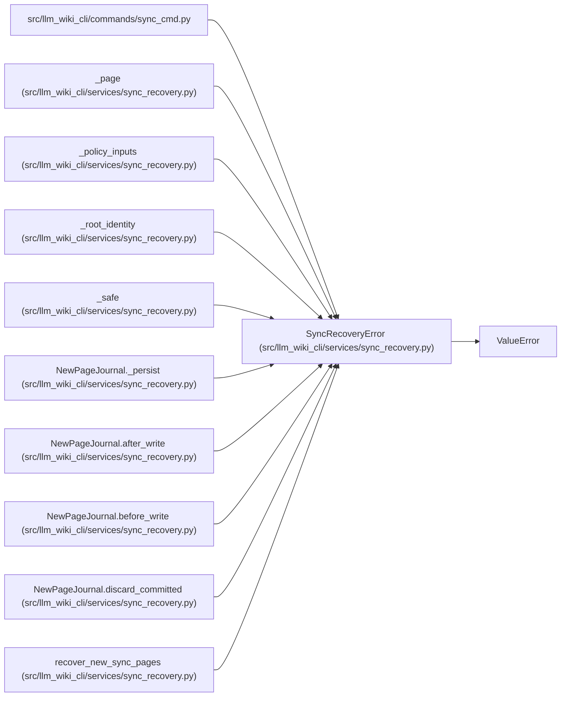

# SyncRecoveryError

**Location:** `src/llm_wiki_cli/services/sync_recovery.py:42`
**Kind:** Class
**Bases:** `ValueError`
**Module:** [sync_recovery](../modules/sync_recovery.md)

## Description

A recovery proof or operation cannot be admitted safely.

## Attributes

*No annotated attributes found.*

## Methods

*No public methods. Inherits from base classes.*

## Relationships

<!-- Auto-generated relationship summary. Do not edit by hand. -->

### Summary

| Module | Methods | Attributes |
|---|---:|---|
| [sync_recovery](../modules/sync_recovery.md) | 0 | — |

### Structure

| Kind | Entity | Module |
|---|---|---|
| Base | `ValueError` | — |

### References

| Reference | Kind | Source | Call sites |
|---|---|---|---:|
| `sync_cmd` | import | [sync_cmd](../modules/sync_cmd.md) | — |
| `_page` | call | [sync_recovery](../modules/sync_recovery.md) | 2 |
| `_policy_inputs` | call | [sync_recovery](../modules/sync_recovery.md) | 1 |
| `_root_identity` | call | [sync_recovery](../modules/sync_recovery.md) | 1 |
| `_safe` | call | [sync_recovery](../modules/sync_recovery.md) | 1 |
| `NewPageJournal._persist` | call | [sync_recovery](../modules/sync_recovery.md) | 1 |
| `NewPageJournal.after_write` | call | [sync_recovery](../modules/sync_recovery.md) | 1 |
| `NewPageJournal.before_write` | call | [sync_recovery](../modules/sync_recovery.md) | 5 |
| `NewPageJournal.discard_committed` | call | [sync_recovery](../modules/sync_recovery.md) | 5 |
| `recover_new_sync_pages` | call | [sync_recovery](../modules/sync_recovery.md) | 28 |
