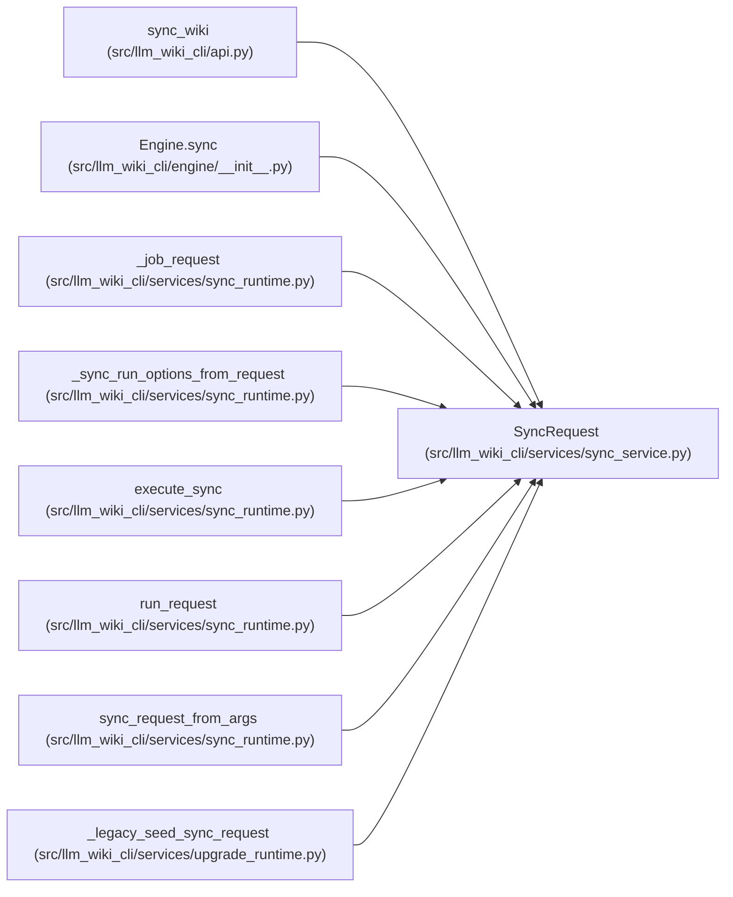

# SyncRequest

**Location:** `src/llm_wiki_cli/services/sync_service.py:23`
**Kind:** Class
**Bases:** —
**Module:** [sync_service](../modules/sync_service.md)

**Decorators:** `@dataclass(frozen=True)`

## Description

One incremental sync of ``wiki_root`` from ``source_root``.

Field names describe the behaviour, not CLI flags: ``plugins=False`` is
``--no-plugins`` and ``cache=False`` is ``--no-cache``.

## Attributes

| Name | Type | Default | Description |
|------|------|---------|-------------|
| `source_root` | `str \| Path` | `'.'` | — |
| `wiki_root` | `str \| Path` | `DEFAULT_WIKI_DIR` | — |
| `dry_run` | `bool` | `False` | — |
| `force` | `bool` | `False` | — |
| `plugins` | `bool` | `True` | — |
| `preserve_semantic` | `bool` | `True` | — |
| `initialize_surfaces` | `Iterable[str] \| None` | `None` | — |
| `flow_categories` | `Iterable[str] \| None` | `None` | — |
| `exclude_tests` | `bool` | `False` | — |
| `include_tests` | `Iterable[str] \| None` | `None` | — |
| `openapi_file` | `str \| Path \| None` | `None` | — |
| `clear_openapi_file` | `bool` | `False` | — |
| `source_selection` | `str \| Path \| None` | `None` | — |
| `repair_evidence` | `Iterable[str] \| None` | `None` | — |
| `allow_external_source` | `bool` | `False` | — |
| `rebuild_knowledge` | `bool` | `False` | — |
| `knowledge_format` | `str \| None` | `None` | — |
| `helper_cache_dir` | `str \| Path \| None` | `None` | — |
| `jobs` | `int` | `1` | — |
| `requested_jobs` | `int \| Literal['auto'] \| None` | `None` | — |
| `cache` | `bool` | `True` | — |
| `rebuild_cache` | `bool` | `False` | — |
| `cache_dir` | `str \| Path \| None` | `None` | — |
| `cache_stats` | `bool` | `False` | — |
| `prune_storage` | `bool` | `False` | — |
| `storage_recovery_dir` | `str \| Path \| None` | `None` | — |

## Methods

*No declared methods.*

## Relationships

<!-- Auto-generated relationship summary. Do not edit by hand. -->

### Summary

| Module | Methods | Attributes |
|---|---:|---|
| [sync_service](../modules/sync_service.md) | 0 | `allow_external_source`, `cache`, `cache_dir`, `cache_stats`, `clear_openapi_file`, `dry_run`, `exclude_tests`, `flow_categories`, `force`, `helper_cache_dir`, `include_tests`, `initialize_surfaces` |

### References

| Reference | Kind | Source | Call sites |
|---|---|---|---:|
| `sync_wiki` | call | [api](../modules/api.md) | 1 |
| `Engine.sync` | type_reference | [engine___init__](../modules/engine___init__.md) | — |
| `_job_request` | type_reference | [sync_runtime](../modules/sync_runtime.md) | — |
| `_sync_run_options_from_request` | type_reference | [sync_runtime](../modules/sync_runtime.md) | — |
| `execute_sync` | type_reference | [sync_runtime](../modules/sync_runtime.md) | — |
| `run_request` | type_reference | [sync_runtime](../modules/sync_runtime.md) | — |
| `sync_request_from_args` | call | [sync_runtime](../modules/sync_runtime.md) | 1 |
| `sync_request_from_args` | type_reference | [sync_runtime](../modules/sync_runtime.md) | — |
| `_legacy_seed_sync_request` | call | [upgrade_runtime](../modules/upgrade_runtime.md) | 1 |
