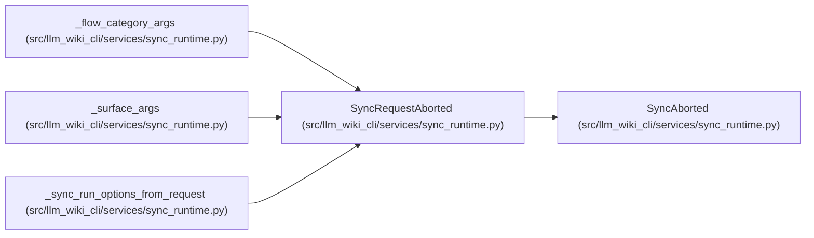

# SyncRequestAborted

**Location:** `src/llm_wiki_cli/services/sync_runtime.py:273`
**Kind:** Class
**Bases:** `SyncAborted`
**Module:** [sync_runtime](../modules/sync_runtime.md)

## Description

The request's options were rejected before any sync work started.

## Attributes

*No annotated attributes found.*

## Methods

*No declared methods.*

## Relationships

<!-- Auto-generated relationship summary. Do not edit by hand. -->

### Summary

| Module | Methods | Attributes |
|---|---:|---|
| [sync_runtime](../modules/sync_runtime.md) | 0 | — |

### Structure

| Kind | Entity | Module |
|---|---|---|
| Base | `SyncAborted` | [sync_runtime](../modules/sync_runtime.md) |

### References

| Reference | Kind | Source | Call sites |
|---|---|---|---:|
| `_flow_category_args` | call | [sync_runtime](../modules/sync_runtime.md) | 1 |
| `_surface_args` | call | [sync_runtime](../modules/sync_runtime.md) | 1 |
| `_sync_run_options_from_request` | call | [sync_runtime](../modules/sync_runtime.md) | 4 |
