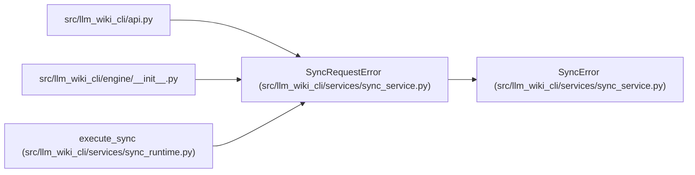

# SyncRequestError

**Location:** `src/llm_wiki_cli/services/sync_service.py:94`
**Kind:** Class
**Bases:** `SyncError`
**Module:** [sync_service](../modules/sync_service.md)

## Description

The request's options are invalid or contradict each other.

## Attributes

*No annotated attributes found.*

## Methods

*No declared methods.*

## Relationships

<!-- Auto-generated relationship summary. Do not edit by hand. -->

### Summary

| Module | Methods | Attributes |
|---|---:|---|
| [sync_service](../modules/sync_service.md) | 0 | — |

### Structure

| Kind | Entity | Module |
|---|---|---|
| Base | `SyncError` | [sync_service](../modules/sync_service.md) |

### References

| Reference | Kind | Source | Call sites |
|---|---|---|---:|
| `api` | import | [api](../modules/api.md) | — |
| `__init__` | import | [engine___init__](../modules/engine___init__.md) | — |
| `execute_sync` | call | [sync_runtime](../modules/sync_runtime.md) | 2 |
