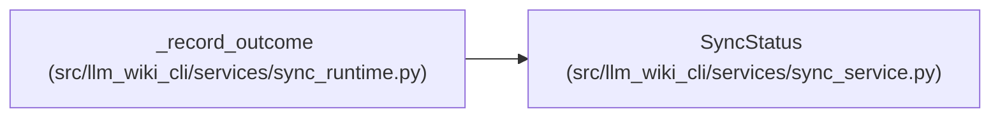

# SyncStatus

**Location:** `src/llm_wiki_cli/services/sync_service.py:19`
**Kind:** Type alias
**Bases:** —
**Module:** [sync_service](../modules/sync_service.md)
**Target:** `Literal['synced', 'up-to-date', 'no-change']`

## Description

_Auto-generated from `SyncStatus` in `src/llm_wiki_cli/services/sync_service.py`._

## Attributes

*See the alias definition for its member types.*

## Methods

*See the alias definition for callable and member types.*

## Relationships

<!-- Auto-generated relationship summary. Do not edit by hand. -->

### Summary

| Module | Methods | Attributes |
|---|---:|---|
| [sync_service](../modules/sync_service.md) | 0 | — |

### References

| Reference | Kind | Source | Call sites |
|---|---|---|---:|
| `_record_outcome` | type_reference | [sync_runtime](../modules/sync_runtime.md) | — |
