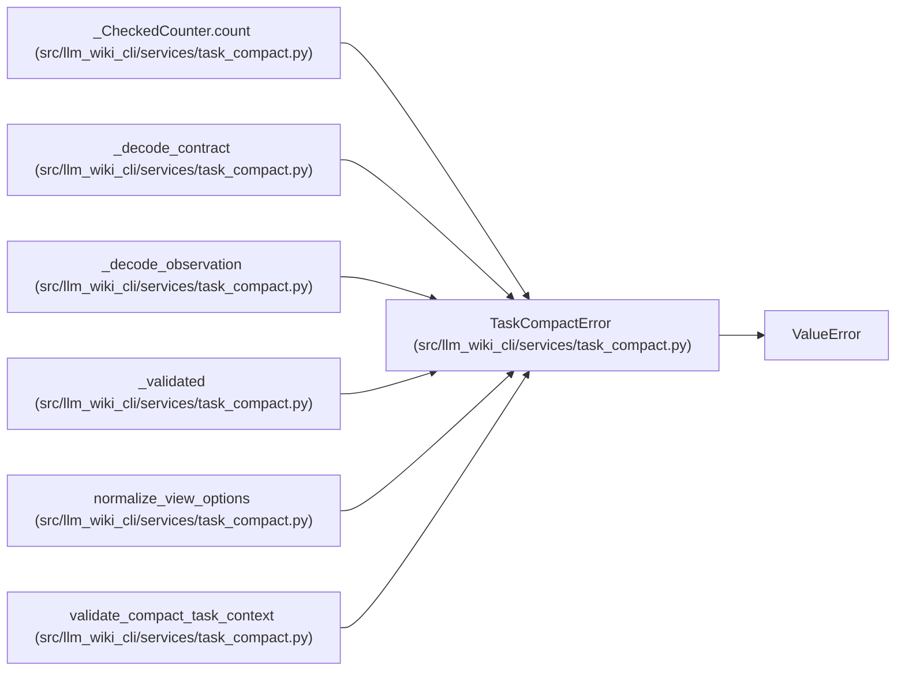

# TaskCompactError

**Location:** `src/llm_wiki_cli/services/task_compact.py:75`
**Kind:** Class
**Bases:** `ValueError`
**Module:** [task_compact](../modules/task_compact.md)

## Description

_Auto-generated from `TaskCompactError` in `src/llm_wiki_cli/services/task_compact.py`._

## Attributes

*No annotated attributes found.*

## Methods

| Method | Signature | Decorators | Description |
|--------|-----------|------------|-------------|
| `__init__` | `(code, message)` | — | — |

## Relationships

<!-- Auto-generated relationship summary. Do not edit by hand. -->

### Summary

| Module | Methods | Attributes |
|---|---:|---|
| [task_compact](../modules/task_compact.md) | 1 | — |

### Structure

| Kind | Entity | Module |
|---|---|---|
| Base | `ValueError` | — |

### References

| Reference | Kind | Source | Call sites |
|---|---|---|---:|
| `_CheckedCounter.count` | call | [task_compact](../modules/task_compact.md) | 3 |
| `_decode_contract` | call | [task_compact](../modules/task_compact.md) | 2 |
| `_decode_observation` | call | [task_compact](../modules/task_compact.md) | 1 |
| `_validated` | call | [task_compact](../modules/task_compact.md) | 4 |
| `normalize_view_options` | call | [task_compact](../modules/task_compact.md) | 2 |
| `validate_compact_task_context` | call | [task_compact](../modules/task_compact.md) | 3 |
