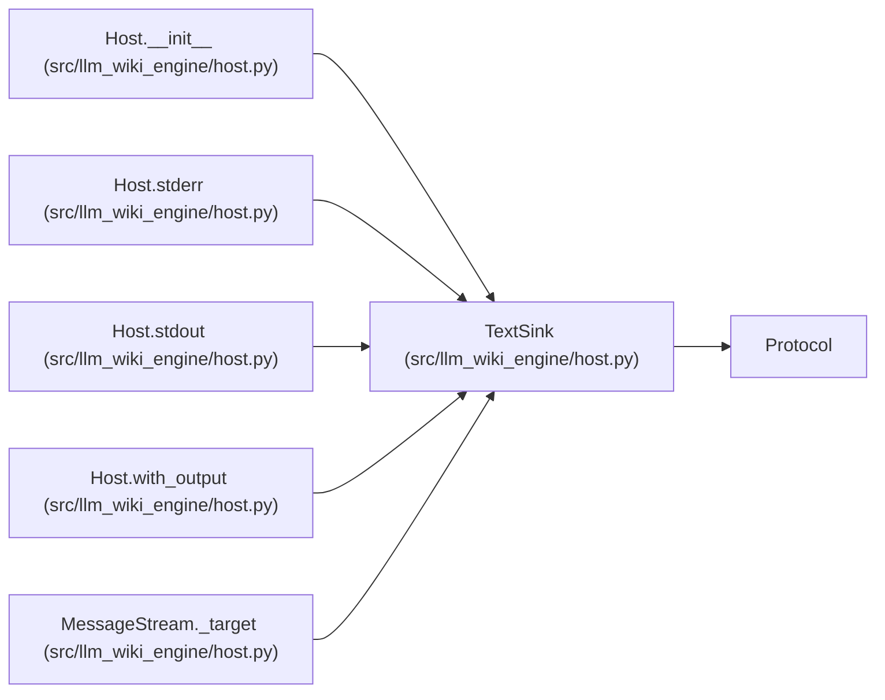

# TextSink

**Location:** `src/llm_wiki_engine/host.py:43`
**Kind:** Class
**Bases:** `Protocol`
**Module:** [host](../modules/host.md)

## Description

A writable text stream, such as ``sys.stdout`` or ``io.StringIO``.

## Attributes

*No annotated attributes found.*

## Methods

| Method | Signature | Decorators | Description |
|--------|-----------|------------|-------------|
| `write` | `(text: str, /) -> object` | — | — |
| `flush` | `() -> object` | — | — |

## Relationships

<!-- Auto-generated relationship summary. Do not edit by hand. -->

### Summary

| Module | Methods | Attributes |
|---|---:|---|
| [host](../modules/host.md) | 2 | — |

### Structure

| Kind | Entity | Module |
|---|---|---|
| Base | `Protocol` | — |

### References

| Reference | Kind | Source | Call sites |
|---|---|---|---:|
| `Host.__init__` | type_reference | [host](../modules/host.md) | — |
| `Host.stderr` | type_reference | [host](../modules/host.md) | — |
| `Host.stdout` | type_reference | [host](../modules/host.md) | — |
| `Host.with_output` | type_reference | [host](../modules/host.md) | — |
| `MessageStream._target` | type_reference | [host](../modules/host.md) | — |
