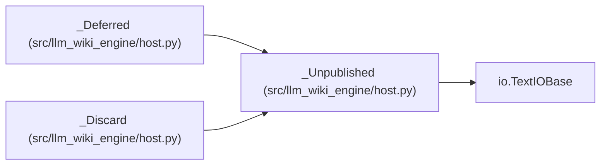

# _Unpublished

**Location:** `src/llm_wiki_engine/host.py:238`
**Kind:** Class
**Bases:** `io.TextIOBase`
**Module:** [host](../modules/host.md)

## Description

_Auto-generated from `_Unpublished` in `src/llm_wiki_engine/host.py`._

## Attributes

*No annotated attributes found.*

## Methods

| Method | Signature | Decorators | Description |
|--------|-----------|------------|-------------|
| `writable` | `() -> bool` | — | — |

## Relationships

<!-- Auto-generated relationship summary. Do not edit by hand. -->

### Summary

| Module | Methods | Attributes |
|---|---:|---|
| [host](../modules/host.md) | 1 | — |

### Structure

| Kind | Entity | Module |
|---|---|---|
| Base | `io.TextIOBase` | — |
| Subclass | `_Deferred` | [host](../modules/host.md) |
| Subclass | `_Discard` | [host](../modules/host.md) |
