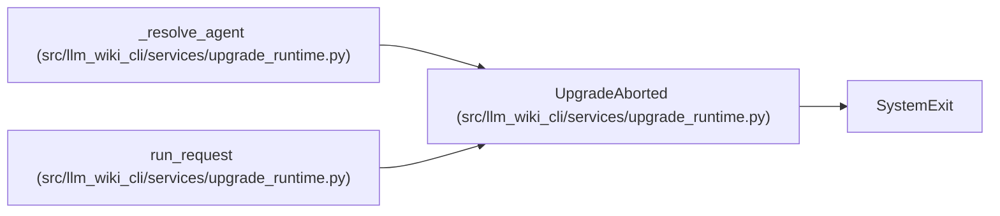

# UpgradeAborted

**Location:** `src/llm_wiki_cli/services/upgrade_runtime.py:610`
**Kind:** Class
**Bases:** `SystemExit`
**Module:** [upgrade_runtime](../modules/upgrade_runtime.md)

## Description

Upgrade stopped with an exit status; ``message`` says why when no error line did.

## Attributes

*No annotated attributes found.*

## Methods

| Method | Signature | Decorators | Description |
|--------|-----------|------------|-------------|
| `__init__` | `(code: int, message: str = '') -> None` | — | — |

## Relationships

<!-- Auto-generated relationship summary. Do not edit by hand. -->

### Summary

| Module | Methods | Attributes |
|---|---:|---|
| [upgrade_runtime](../modules/upgrade_runtime.md) | 1 | — |

### Structure

| Kind | Entity | Module |
|---|---|---|
| Base | `SystemExit` | — |

### References

| Reference | Kind | Source | Call sites |
|---|---|---|---:|
| `_resolve_agent` | call | [upgrade_runtime](../modules/upgrade_runtime.md) | 2 |
| `run_request` | call | [upgrade_runtime](../modules/upgrade_runtime.md) | 26 |
