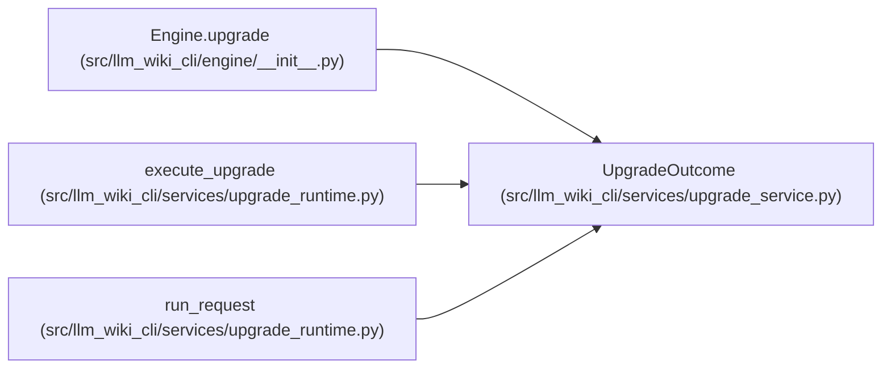

# UpgradeOutcome

**Location:** `src/llm_wiki_cli/services/upgrade_service.py:42`
**Kind:** Class
**Bases:** —
**Module:** [upgrade_service](../modules/upgrade_service.md)

**Decorators:** `@dataclass(frozen=True)`

## Description

What one upgrade did; human-readable progress went to the host streams.

``status`` is ``source-cleanup-pending`` when the target is usable but the
previous agent's files were kept for an explicit retry.

## Attributes

| Name | Type | Default | Description |
|------|------|---------|-------------|
| `status` | `UpgradeStatus` | *required* | — |
| `agent` | `str` | *required* | — |
| `previous_agent` | `str \| None` | `None` | — |
| `schema_file` | `str` | `''` | — |
| `reference_skill` | `str` | `''` | — |
| `legacy_hooks_removed` | `int` | `0` | — |
| `created_entries` | `Sequence[str]` | `()` | — |
| `recovery_dir` | `str \| None` | `None` | — |

## Methods

| Method | Signature | Decorators | Description |
|--------|-----------|------------|-------------|
| `to_dict` | `() -> dict[str, Any]` | — | — |

## Relationships

<!-- Auto-generated relationship summary. Do not edit by hand. -->

### Summary

| Module | Methods | Attributes |
|---|---:|---|
| [upgrade_service](../modules/upgrade_service.md) | 1 | `agent`, `created_entries`, `legacy_hooks_removed`, `previous_agent`, `recovery_dir`, `reference_skill`, `schema_file`, `status` |

### References

| Reference | Kind | Source | Call sites |
|---|---|---|---:|
| `Engine.upgrade` | type_reference | [engine___init__](../modules/engine___init__.md) | — |
| `execute_upgrade` | type_reference | [upgrade_runtime](../modules/upgrade_runtime.md) | — |
| `run_request` | call | [upgrade_runtime](../modules/upgrade_runtime.md) | 1 |
| `run_request` | type_reference | [upgrade_runtime](../modules/upgrade_runtime.md) | — |
