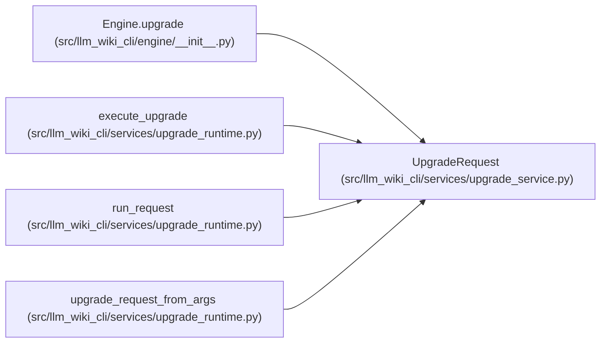

# UpgradeRequest

**Location:** `src/llm_wiki_cli/services/upgrade_service.py:20`
**Kind:** Class
**Bases:** —
**Module:** [upgrade_service](../modules/upgrade_service.md)

**Decorators:** `@dataclass(frozen=True)`

## Description

One in-place refresh of the managed agent schema, skills and wiki layout.

``None`` keeps the stored preference: ``agent`` and the
``quality_hints``/``reference_skill``/``issue_reporting`` switches fall
back to the local agent config, and ``source_root`` to the recorded
source root. ``cleanup_source_agent`` names the previous agent whose
managed files may be removed after a switch.

## Attributes

| Name | Type | Default | Description |
|------|------|---------|-------------|
| `wiki_root` | `str \| Path` | `DEFAULT_WIKI_DIR` | — |
| `source_root` | `str \| Path \| None` | `None` | — |
| `agent` | `str \| None` | `None` | — |
| `cleanup_source_agent` | `str \| None` | `None` | — |
| `quality_hints` | `bool \| None` | `None` | — |
| `reference_skill` | `bool \| None` | `None` | — |
| `issue_reporting` | `bool \| None` | `None` | — |
| `source_selection` | `str \| Path \| None` | `None` | — |
| `helper_cache_dir` | `str \| Path \| None` | `None` | — |

## Methods

*No declared methods.*

## Relationships

<!-- Auto-generated relationship summary. Do not edit by hand. -->

### Summary

| Module | Methods | Attributes |
|---|---:|---|
| [upgrade_service](../modules/upgrade_service.md) | 0 | `agent`, `cleanup_source_agent`, `helper_cache_dir`, `issue_reporting`, `quality_hints`, `reference_skill`, `source_root`, `source_selection`, `wiki_root` |

### References

| Reference | Kind | Source | Call sites |
|---|---|---|---:|
| `Engine.upgrade` | type_reference | [engine___init__](../modules/engine___init__.md) | — |
| `execute_upgrade` | type_reference | [upgrade_runtime](../modules/upgrade_runtime.md) | — |
| `run_request` | type_reference | [upgrade_runtime](../modules/upgrade_runtime.md) | — |
| `upgrade_request_from_args` | call | [upgrade_runtime](../modules/upgrade_runtime.md) | 1 |
| `upgrade_request_from_args` | type_reference | [upgrade_runtime](../modules/upgrade_runtime.md) | — |
