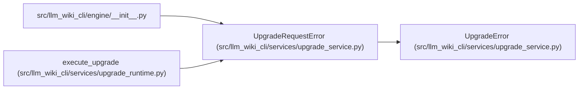

# UpgradeRequestError

**Location:** `src/llm_wiki_cli/services/upgrade_service.py:79`
**Kind:** Class
**Bases:** `UpgradeError`
**Module:** [upgrade_service](../modules/upgrade_service.md)

## Description

The request names a path the workspace policy rejects.

## Attributes

*No annotated attributes found.*

## Methods

*No declared methods.*

## Relationships

<!-- Auto-generated relationship summary. Do not edit by hand. -->

### Summary

| Module | Methods | Attributes |
|---|---:|---|
| [upgrade_service](../modules/upgrade_service.md) | 0 | — |

### Structure

| Kind | Entity | Module |
|---|---|---|
| Base | `UpgradeError` | [upgrade_service](../modules/upgrade_service.md) |

### References

| Reference | Kind | Source | Call sites |
|---|---|---|---:|
| `__init__` | import | [engine___init__](../modules/engine___init__.md) | — |
| `execute_upgrade` | call | [upgrade_runtime](../modules/upgrade_runtime.md) | 1 |
