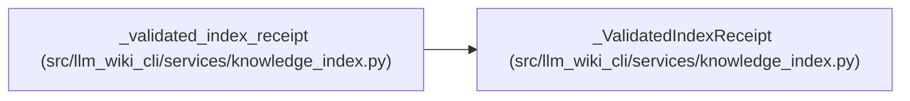

# _ValidatedIndexReceipt

**Location:** `src/llm_wiki_cli/services/knowledge_index.py:370`
**Kind:** Class
**Bases:** —
**Module:** [knowledge_index](../modules/knowledge_index.md)

**Decorators:** `@dataclass(frozen=True)`

## Description

_Auto-generated from `_ValidatedIndexReceipt` in `src/llm_wiki_cli/services/knowledge_index.py`._

## Attributes

| Name | Type | Default | Description |
|------|------|---------|-------------|
| `model` | `KnowledgeIndex` | *required* | — |
| `content` | `bytes` | *required* | — |
| `wiki_root` | `Path` | *required* | — |
| `_proof` | `_IndexValidationProof \| None` | `field(default=None, init=False, repr=False, compare=False)` | — |

## Methods

| Method | Signature | Decorators | Description |
|--------|-----------|------------|-------------|
| `__deepcopy__` | `(memo)` | — | — |

## Relationships

<!-- Auto-generated relationship summary. Do not edit by hand. -->

### Summary

| Module | Methods | Attributes |
|---|---:|---|
| [knowledge_index](../modules/knowledge_index.md) | 1 | `_proof`, `content`, `model`, `wiki_root` |

### References

| Reference | Kind | Source | Call sites |
|---|---|---|---:|
| `_validated_index_receipt` | call | [knowledge_index](../modules/knowledge_index.md) | 1 |
| `_validated_index_receipt` | type_reference | [knowledge_index](../modules/knowledge_index.md) | — |
