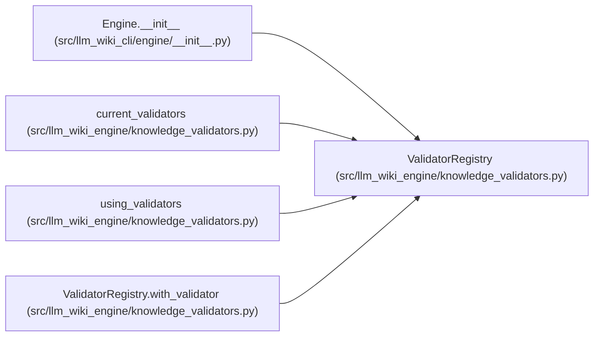

# ValidatorRegistry

**Location:** `src/llm_wiki_engine/knowledge_validators.py:66`
**Kind:** Class
**Bases:** —
**Module:** [knowledge_validators](../modules/knowledge_validators.md)

**Decorators:** `@dataclass(frozen=True)`

## Description

Ordered model validators plus the modules that define core parsing.

## Attributes

| Name | Type | Default | Description |
|------|------|---------|-------------|
| `validators` | `tuple[ModelValidator, ...]` | *required* | — |
| `core_modules` | `tuple[str, ...]` | *required* | — |

## Methods

| Method | Signature | Decorators | Description |
|--------|-----------|------------|-------------|
| `__post_init__` | `() -> None` | — | — |
| `names` | `() -> tuple[str, ...]` | `@property` | — |
| `with_validator` | `(validator: ModelValidator) -> ValidatorRegistry` | — | A copy of this registry that also runs ``validator``, last. |
| `modules` | `() -> tuple[str, ...]` | — | Every module that defines acceptance, each once, in a stable order. |
| `run` | `(model: KnowledgeIndex) -> None` | — | Run every validator on ``model``; the first rejection propagates. |
| `identity` | `() -> tuple` | — | A value that changes whenever what this registry accepts may change. |

## Relationships

<!-- Auto-generated relationship summary. Do not edit by hand. -->

### Summary

| Module | Methods | Attributes |
|---|---:|---|
| [knowledge_validators](../modules/knowledge_validators.md) | 6 | `core_modules`, `validators` |

### References

| Reference | Kind | Source | Call sites |
|---|---|---|---:|
| `Engine.__init__` | type_reference | [engine___init__](../modules/engine___init__.md) | — |
| `current_validators` | type_reference | [knowledge_validators](../modules/knowledge_validators.md) | — |
| `using_validators` | type_reference | [knowledge_validators](../modules/knowledge_validators.md) | — |
| `ValidatorRegistry.with_validator` | type_reference | [knowledge_validators](../modules/knowledge_validators.md) | — |
