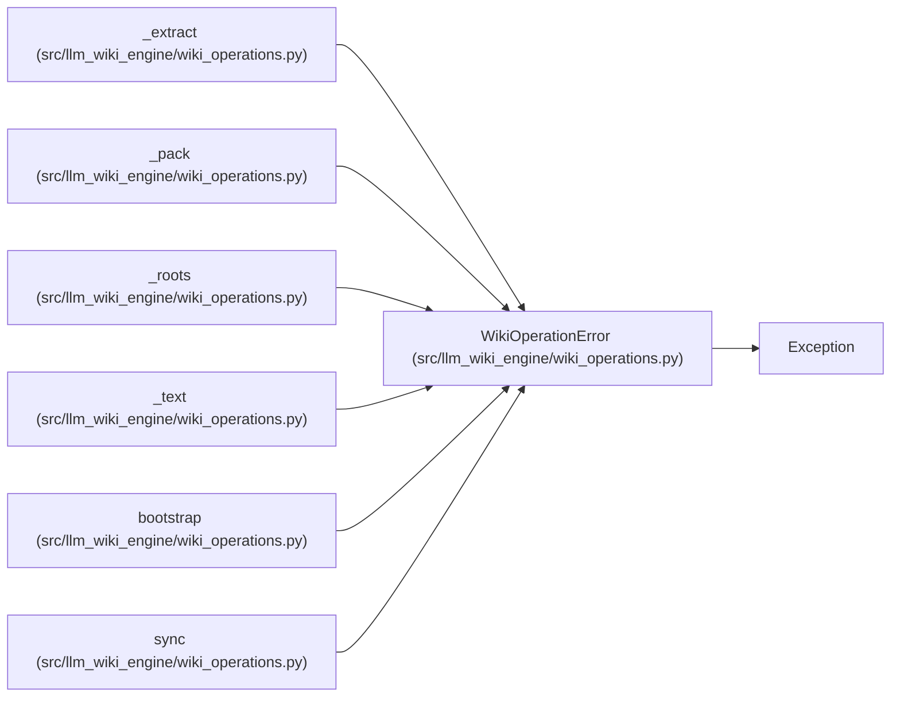

# WikiOperationError

**Location:** `src/llm_wiki_engine/wiki_operations.py:39`
**Kind:** Class
**Bases:** `Exception`
**Module:** [wiki_operations](../modules/wiki_operations.md)

## Description

A wiki use case cannot complete; the message says why.

## Attributes

*No annotated attributes found.*

## Methods

*No declared methods.*

## Relationships

<!-- Auto-generated relationship summary. Do not edit by hand. -->

### Summary

| Module | Methods | Attributes |
|---|---:|---|
| [wiki_operations](../modules/wiki_operations.md) | 0 | — |

### Structure

| Kind | Entity | Module |
|---|---|---|
| Base | `Exception` | — |

### References

| Reference | Kind | Source | Call sites |
|---|---|---|---:|
| `_extract` | call | [wiki_operations](../modules/wiki_operations.md) | 3 |
| `_pack` | call | [wiki_operations](../modules/wiki_operations.md) | 1 |
| `_roots` | call | [wiki_operations](../modules/wiki_operations.md) | 1 |
| `_text` | call | [wiki_operations](../modules/wiki_operations.md) | 1 |
| `bootstrap` | call | [wiki_operations](../modules/wiki_operations.md) | 1 |
| `sync` | call | [wiki_operations](../modules/wiki_operations.md) | 2 |
