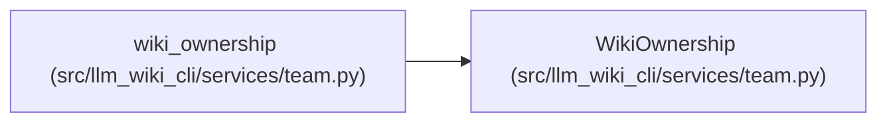

# WikiOwnership

**Location:** `src/llm_wiki_cli/services/team.py:84`
**Kind:** Class
**Bases:** —
**Module:** [team](../modules/team.md)

**Decorators:** `@dataclass(frozen=True)`

## Description

Which branches may write generated wiki state.

``branch`` lets every branch sync its own copy. ``trunk`` reserves
generated state for the trunk and the named writer branches, so other
branches never carry it and cannot conflict on it.

## Attributes

| Name | Type | Default | Description |
|------|------|---------|-------------|
| `mode` | `str` | `OWNERSHIP_BRANCH` | — |
| `trunk` | `str` | `_DEFAULT_TRUNK` | — |
| `writer_branches` | `tuple[str, ...]` | `()` | — |
| `authored_paths` | `tuple[str, ...]` | `_DEFAULT_AUTHORED_PATHS` | — |

## Methods

| Method | Signature | Decorators | Description |
|--------|-----------|------------|-------------|
| `trunk_owned` | `() -> bool` | `@property` | — |
| `may_write` | `(branch: str \| None) -> bool` | — | Return whether ``branch`` may write generated wiki state. |
| `is_authored` | `(wiki_relative_path: str) -> bool` | — | Return whether a wiki-relative path is authored, not generated. |
| `to_dict` | `() -> dict[str, Any]` | — | — |

## Relationships

<!-- Auto-generated relationship summary. Do not edit by hand. -->

### Summary

| Module | Methods | Attributes |
|---|---:|---|
| [team](../modules/team.md) | 4 | `authored_paths`, `mode`, `trunk`, `writer_branches` |

### References

| Reference | Kind | Source | Call sites |
|---|---|---|---:|
| `wiki_ownership` | call | [team](../modules/team.md) | 2 |
| `wiki_ownership` | type_reference | [team](../modules/team.md) | — |
