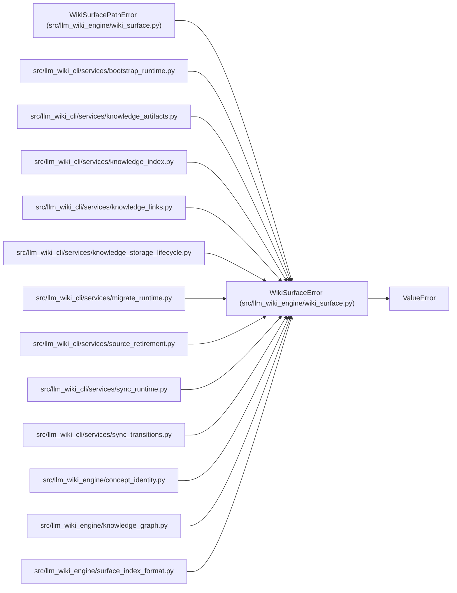

# WikiSurfaceError

**Location:** `src/llm_wiki_engine/wiki_surface.py:25`
**Kind:** Class
**Bases:** `ValueError`
**Module:** [wiki_surface](../modules/wiki_surface.md)

## Description

Raised for invalid wiki surface lookups.

## Attributes

*No annotated attributes found.*

## Methods

*No declared methods.*

## Relationships

<!-- Auto-generated relationship summary. Do not edit by hand. -->

### Summary

| Module | Methods | Attributes |
|---|---:|---|
| [wiki_surface](../modules/wiki_surface.md) | 0 | — |

### Structure

| Kind | Entity | Module |
|---|---|---|
| Base | `ValueError` | — |
| Subclass | `WikiSurfacePathError` | [wiki_surface](../modules/wiki_surface.md) |

### References

| Reference | Kind | Source | Call sites |
|---|---|---|---:|
| `bootstrap_runtime` | import | [bootstrap_runtime](../modules/bootstrap_runtime.md) | — |
| `knowledge_artifacts` | import | [knowledge_artifacts](../modules/knowledge_artifacts.md) | — |
| `knowledge_index` | import | [knowledge_index](../modules/knowledge_index.md) | — |
| `knowledge_links` | import | [knowledge_links](../modules/knowledge_links.md) | — |
| `knowledge_storage_lifecycle` | import | [knowledge_storage_lifecycle](../modules/knowledge_storage_lifecycle.md) | — |
| `migrate_runtime` | import | [migrate_runtime](../modules/migrate_runtime.md) | — |
| `source_retirement` | import | [source_retirement](../modules/source_retirement.md) | — |
| `sync_runtime` | import | [sync_runtime](../modules/sync_runtime.md) | — |
| `sync_transitions` | import | [sync_transitions](../modules/sync_transitions.md) | — |
| `concept_identity` | import | [concept_identity](../modules/concept_identity.md) | — |
| `knowledge_graph` | import | [knowledge_graph](../modules/knowledge_graph.md) | — |
| `surface_index_format` | import | [surface_index_format](../modules/surface_index_format.md) | — |

> References: showing 12 of 18 logical references; 6 omitted by the 12-row generated summary limit.
