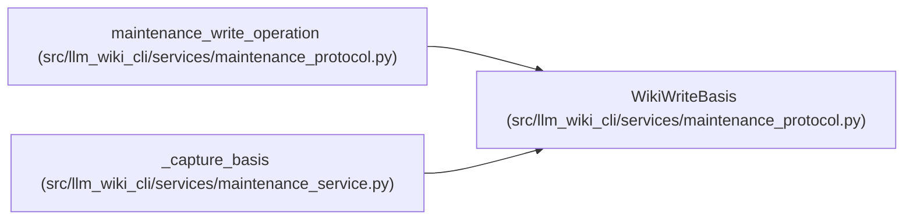

# WikiWriteBasis

**Location:** `src/llm_wiki_cli/services/maintenance_protocol.py:156`
**Kind:** Class
**Bases:** —
**Module:** [maintenance_protocol](../modules/maintenance_protocol.md)

**Decorators:** `@dataclass`

## Description

_Auto-generated from `WikiWriteBasis` in `src/llm_wiki_cli/services/maintenance_protocol.py`._

## Attributes

| Name | Type | Default | Description |
|------|------|---------|-------------|
| `root` | `Path` | *required* | — |
| `expected` | `dict[str, bytes]` | *required* | — |
| `source_snapshot` | `SourceSnapshot \| None` | `None` | — |
| `recovery_directory` | `Path \| None` | `None` | — |
| `eligible_images` | `dict[str, list[str \| None]] \| None` | `None` | — |
| `preimages` | `dict[str, bytes]` | `field(init=False)` | — |

## Methods

| Method | Signature | Decorators | Description |
|--------|-----------|------------|-------------|
| `__post_init__` | `()` | — | — |
| `_relative` | `(path: Path) -> str \| None` | — | — |
| `before_write` | `(path: Path, content: bytes \| None) -> None` | — | — |
| `after_write` | `(path: Path, content: bytes \| None) -> None` | — | — |
| `assert_current` | `() -> None` | — | — |
| `assert_source_current` | `() -> None` | — | — |

## Relationships

<!-- Auto-generated relationship summary. Do not edit by hand. -->

### Summary

| Module | Methods | Attributes |
|---|---:|---|
| [maintenance_protocol](../modules/maintenance_protocol.md) | 6 | `eligible_images`, `expected`, `preimages`, `recovery_directory`, `root`, `source_snapshot` |

### References

| Reference | Kind | Source | Call sites |
|---|---|---|---:|
| `maintenance_write_operation` | call | [maintenance_protocol](../modules/maintenance_protocol.md) | 1 |
| `_capture_basis` | call | [maintenance_service](../modules/maintenance_service.md) | 1 |
