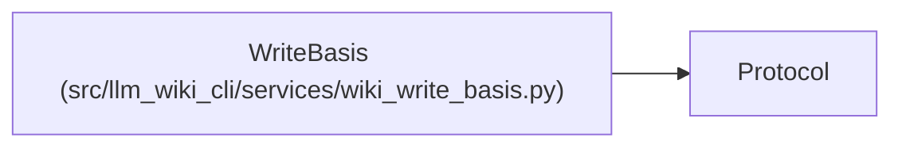

# WriteBasis

**Location:** `src/llm_wiki_cli/services/wiki_write_basis.py:11`
**Kind:** Class
**Bases:** `Protocol`
**Module:** [wiki_write_basis](../modules/wiki_write_basis.md)

## Description

_Auto-generated from `WriteBasis` in `src/llm_wiki_cli/services/wiki_write_basis.py`._

## Attributes

| Name | Type | Default | Description |
|------|------|---------|-------------|
| `root` | `Path` | *required* | — |
| `preimages` | `dict[str, bytes]` | *required* | — |
| `expected` | `dict[str, bytes]` | *required* | — |
| `source_snapshot` | `SourceSnapshot \| None` | *required* | — |

## Methods

| Method | Signature | Decorators | Description |
|--------|-----------|------------|-------------|
| `assert_current` | `() -> None` | — | — |
| `before_write` | `(path: Path, content: bytes \| None) -> None` | — | — |
| `after_write` | `(path: Path, content: bytes \| None) -> None` | — | — |

## Relationships

<!-- Auto-generated relationship summary. Do not edit by hand. -->

### Summary

| Module | Methods | Attributes |
|---|---:|---|
| [wiki_write_basis](../modules/wiki_write_basis.md) | 3 | `expected`, `preimages`, `root`, `source_snapshot` |

### Structure

| Kind | Entity | Module |
|---|---|---|
| Base | `Protocol` | — |
