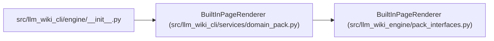

# BuiltInPageRenderer

**Location:** `src/llm_wiki_cli/services/domain_pack.py:96`
**Kind:** Class
**Bases:** `_EngineBuiltInPageRenderer`
**Module:** [domain_pack](../modules/domain_pack.md)

## Description

Today's code-documentation pages; subclass it to adjust them.

## Attributes

*No annotated attributes found.*

## Methods

*No declared methods.*

## Relationships

<!-- Auto-generated relationship summary. Do not edit by hand. -->

### Summary

| Module | Methods | Attributes |
|---|---:|---|
| [domain_pack](../modules/domain_pack.md) | 0 | — |

### Structure

| Kind | Entity | Module |
|---|---|---|
| Base | `BuiltInPageRenderer` | [pack_interfaces](../modules/pack_interfaces.md) |

### References

| Reference | Kind | Source | Call sites |
|---|---|---|---:|
| `__init__` | import | [engine___init__](../modules/engine___init__.md) | — |
