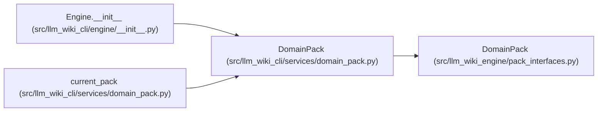

# DomainPack

**Location:** `src/llm_wiki_cli/services/domain_pack.py:288`
**Kind:** Class
**Bases:** `_EngineDomainPack`
**Module:** [domain_pack](../modules/domain_pack.md)

**Decorators:** `@dataclass(frozen=True)`

## Description

A named set of domain decisions: classification, naming, rendering, context,
references and analysis helpers.

Unless given, a pack uses today's code-documentation parts: stem page
names, the built-in pages, code context, the built-in reference providers
and the bundled analysis helpers.

## Attributes

| Name | Type | Default | Description |
|------|------|---------|-------------|
| `page_namer` | `PageNamer` | `field(default_factory=lambda: StemPageNamer())` | — |
| `page_renderer` | `PageRenderer` | `field(default_factory=lambda: BuiltInPageRenderer())` | — |
| `context_source` | `ContextSource` | `field(default_factory=lambda: CodeContextSource())` | — |
| `reference_providers` | `tuple[ReferenceProvider, ...]` | `BUILTIN_REFERENCE_PROVIDERS` | — |
| `helper_toolchain` | `HelperToolchain` | `field(default_factory=lambda: BundledHelperToolchain())` | — |

## Methods

| Method | Signature | Decorators | Description |
|--------|-----------|------------|-------------|
| `__post_init__` | `() -> None` | — | — |

## Relationships

<!-- Auto-generated relationship summary. Do not edit by hand. -->

### Summary

| Module | Methods | Attributes |
|---|---:|---|
| [domain_pack](../modules/domain_pack.md) | 1 | `context_source`, `helper_toolchain`, `page_namer`, `page_renderer`, `reference_providers` |

### Structure

| Kind | Entity | Module |
|---|---|---|
| Base | `DomainPack` | [pack_interfaces](../modules/pack_interfaces.md) |

### References

| Reference | Kind | Source | Call sites |
|---|---|---|---:|
| `Engine.__init__` | type_reference | [engine___init__](../modules/engine___init__.md) | — |
| `current_pack` | type_reference | [domain_pack](../modules/domain_pack.md) | — |
