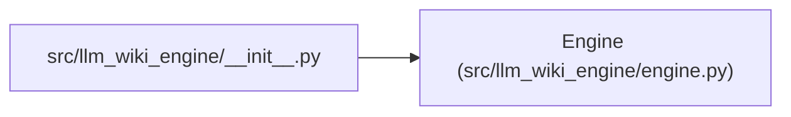

# Engine

**Location:** `src/llm_wiki_engine/engine.py:69`
**Kind:** Class
**Bases:** —
**Module:** [engine](../modules/engine.md)

## Description

One configured engine; independent engines may run side by side.

## Attributes

*No annotated attributes found.*

## Methods

| Method | Signature | Decorators | Description |
|--------|-----------|------------|-------------|
| `__init__` | `(*, pack: DomainPack, host: Host \| None = None, comparison_policy: str = 'auto', validators: ValidatorRegistry = DEFAULT_VALIDATORS, kinds: KindRegistry = DEFAULT_KINDS, integrations: IntegrationSet = DEFAULT_INTEGRATIONS) -> None` | — | — |
| `host` | `() -> Host` | `@property` | — |
| `pack` | `() -> DomainPack` | `@property` | — |
| `capabilities` | `() -> dict[str, object]` | — | What this engine may do, as an ``llm-wiki-engine-capabilities/v1`` document. |
| `operation` | `() -> Iterator[Operation]` | `@contextmanager` | Apply this engine's grants to all work inside the block. |
| `call` | `(function: Callable[_P, _R], /, *args: _P.args, **kwargs: _P.kwargs) -> _R` | — | Run ``function`` in one operation; this reports no events. |
| `_run` | `(name: str, request: object, execute: Callable[[], _R], describe: Callable[[_R], Mapping[str, Any]]) -> _R` | — | Run one use case in an operation, reporting its lifecycle to the host. |
| `_report` | `(kind: EventKind, name: str, operation_id: str, data: Callable[[], Mapping[str, Any]]) -> None` | — | — |
| `bootstrap` | `(request: BootstrapRequest) -> BootstrapResult` | — | Create a wiki from the pack's sources; progress goes to the host's streams. |
| `sync` | `(request: SyncRequest) -> SyncResult` | — | Update the wiki from changed sources, keeping reviewed text. |
| `lint` | `(request: LintRequest) -> LintReport` | — | Check the wiki against its sources; ``report.passed`` is the verdict. |

## Relationships

<!-- Auto-generated relationship summary. Do not edit by hand. -->

### Summary

| Module | Methods | Attributes |
|---|---:|---|
| [engine](../modules/engine.md) | 11 | — |

### References

| Reference | Kind | Source | Call sites |
|---|---|---|---:|
| `__init__` | import | [llm_wiki_engine___init__](../modules/llm_wiki_engine___init__.md) | — |
