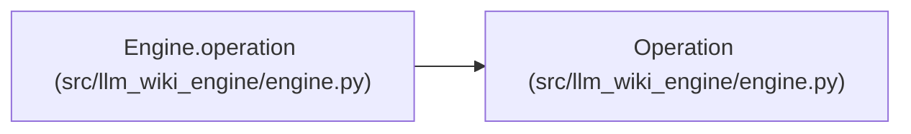

# Operation

**Location:** `src/llm_wiki_engine/engine.py:58`
**Kind:** Class
**Bases:** —
**Module:** [engine](../modules/engine.md)

**Decorators:** `@dataclass(frozen=True)`

## Description

The settings in force for one engine call and everything beneath it.

## Attributes

| Name | Type | Default | Description |
|------|------|---------|-------------|
| `host` | `Host` | *required* | — |
| `pack` | `DomainPack` | *required* | — |
| `comparison_policy` | `str` | *required* | — |
| `validators` | `ValidatorRegistry` | `DEFAULT_VALIDATORS` | — |
| `kinds` | `KindRegistry` | `DEFAULT_KINDS` | — |
| `integrations` | `IntegrationSet` | `DEFAULT_INTEGRATIONS` | — |

## Methods

*No declared methods.*

## Relationships

<!-- Auto-generated relationship summary. Do not edit by hand. -->

### Summary

| Module | Methods | Attributes |
|---|---:|---|
| [engine](../modules/engine.md) | 0 | `comparison_policy`, `host`, `integrations`, `kinds`, `pack`, `validators` |

### References

| Reference | Kind | Source | Call sites |
|---|---|---|---:|
| `Engine.operation` | call | [engine](../modules/engine.md) | 1 |
| `Engine.operation` | type_reference | [engine](../modules/engine.md) | — |
