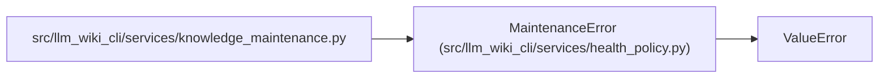

# MaintenanceError

**Location:** `src/llm_wiki_cli/services/health_policy.py:109`
**Kind:** Class
**Bases:** `ValueError`
**Module:** [health_policy](../modules/health_policy.md)

## Description

Maintenance evidence is absent, inconsistent or not bound to this candidate.

## Attributes

*No annotated attributes found.*

## Methods

*No declared methods.*

## Relationships

<!-- Auto-generated relationship summary. Do not edit by hand. -->

### Summary

| Module | Methods | Attributes |
|---|---:|---|
| [health_policy](../modules/health_policy.md) | 0 | — |

### Structure

| Kind | Entity | Module |
|---|---|---|
| Base | `ValueError` | — |

### References

| Reference | Kind | Source | Call sites |
|---|---|---|---:|
| `knowledge_maintenance` | import | [knowledge_maintenance](../modules/knowledge_maintenance.md) | — |
