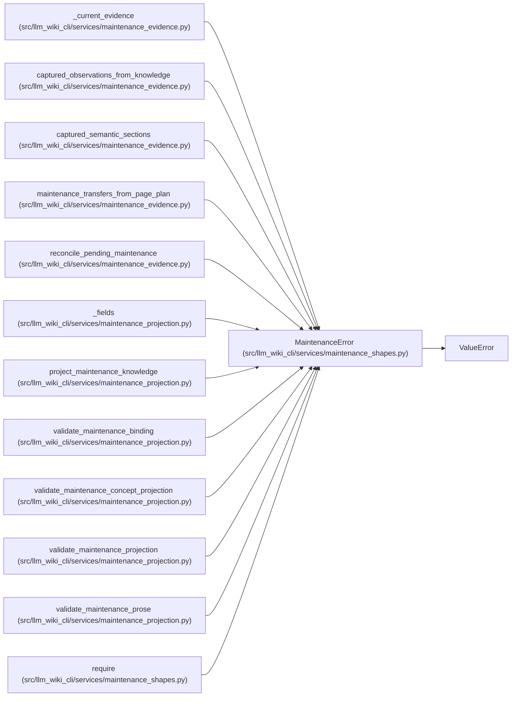

# MaintenanceError

**Location:** `src/llm_wiki_cli/services/maintenance_shapes.py:17`
**Kind:** Class
**Bases:** `ValueError`
**Module:** [maintenance_shapes](../modules/maintenance_shapes.md)

## Description

_Auto-generated from `MaintenanceError` in `src/llm_wiki_cli/services/maintenance_shapes.py`._

## Attributes

*No annotated attributes found.*

## Methods

| Method | Signature | Decorators | Description |
|--------|-----------|------------|-------------|
| `__init__` | `(code: str, message: str)` | — | — |

## Relationships

<!-- Auto-generated relationship summary. Do not edit by hand. -->

### Summary

| Module | Methods | Attributes |
|---|---:|---|
| [maintenance_shapes](../modules/maintenance_shapes.md) | 1 | — |

### Structure

| Kind | Entity | Module |
|---|---|---|
| Base | `ValueError` | — |

### References

| Reference | Kind | Source | Call sites |
|---|---|---|---:|
| `_current_evidence` | call | [maintenance_evidence](../modules/maintenance_evidence.md) | 7 |
| `captured_observations_from_knowledge` | call | [maintenance_evidence](../modules/maintenance_evidence.md) | 2 |
| `captured_semantic_sections` | call | [maintenance_evidence](../modules/maintenance_evidence.md) | 3 |
| `maintenance_transfers_from_page_plan` | call | [maintenance_evidence](../modules/maintenance_evidence.md) | 1 |
| `reconcile_pending_maintenance` | call | [maintenance_evidence](../modules/maintenance_evidence.md) | 2 |
| `_fields` | call | [maintenance_projection](../modules/maintenance_projection.md) | 1 |
| `project_maintenance_knowledge` | call | [maintenance_projection](../modules/maintenance_projection.md) | 1 |
| `validate_maintenance_binding` | call | [maintenance_projection](../modules/maintenance_projection.md) | 1 |
| `validate_maintenance_concept_projection` | call | [maintenance_projection](../modules/maintenance_projection.md) | 6 |
| `validate_maintenance_projection` | call | [maintenance_projection](../modules/maintenance_projection.md) | 5 |
| `validate_maintenance_prose` | call | [maintenance_projection](../modules/maintenance_projection.md) | 4 |
| `require` | call | [maintenance_shapes](../modules/maintenance_shapes.md) | 1 |

> References: showing 12 of 33 logical references; 21 omitted by the 12-row generated summary limit.
