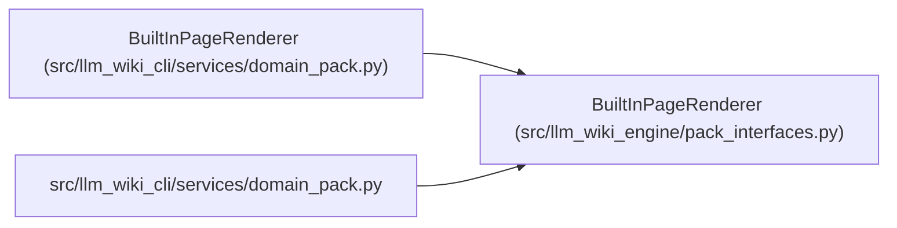

# BuiltInPageRenderer

**Location:** `src/llm_wiki_engine/pack_interfaces.py:327`
**Kind:** Class
**Bases:** —
**Module:** [pack_interfaces](../modules/pack_interfaces.md)

## Description

Writes each page's built-in Markdown unchanged; subclass it to adjust pages.

## Attributes

*No annotated attributes found.*

## Methods

| Method | Signature | Decorators | Description |
|--------|-----------|------------|-------------|
| `render_module` | `(request: ModulePageRequest) -> str` | — | — |
| `render_entity` | `(request: EntityPageRequest) -> str` | — | — |
| `render_page` | `(request: PageRequest) -> str` | — | — |

## Relationships

<!-- Auto-generated relationship summary. Do not edit by hand. -->

### Summary

| Module | Methods | Attributes |
|---|---:|---|
| [pack_interfaces](../modules/pack_interfaces.md) | 3 | — |

### Structure

| Kind | Entity | Module |
|---|---|---|
| Subclass | `BuiltInPageRenderer` | [domain_pack](../modules/domain_pack.md) |

### References

| Reference | Kind | Source | Call sites |
|---|---|---|---:|
| `domain_pack` | import | [domain_pack](../modules/domain_pack.md) | — |
