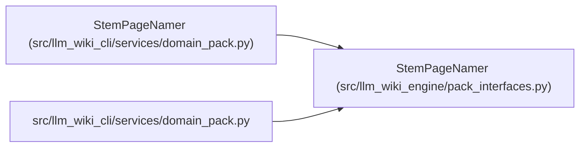

# StemPageNamer

**Location:** `src/llm_wiki_engine/pack_interfaces.py:461`
**Kind:** Class
**Bases:** —
**Module:** [pack_interfaces](../modules/pack_interfaces.md)

## Description

Module pages take the source file stem, entity pages the entity name.

Colliding names are qualified with parent directories (modules) or the
module page (entities), and names that collide on a case-insensitive or
Windows filesystem are made distinct.

## Attributes

*No annotated attributes found.*

## Methods

| Method | Signature | Decorators | Description |
|--------|-----------|------------|-------------|
| `module_pages` | `(inventory: Mapping[str, Mapping[str, Any]]) -> dict[str, str]` | — | — |
| `entity_pages` | `(inventory: Mapping[str, Mapping[str, Any]], module_pages: Mapping[str, str]) -> dict[EntityOccurrenceKey, str]` | — | — |
| `__repr__` | `() -> str` | — | — |

## Relationships

<!-- Auto-generated relationship summary. Do not edit by hand. -->

### Summary

| Module | Methods | Attributes |
|---|---:|---|
| [pack_interfaces](../modules/pack_interfaces.md) | 3 | — |

### Structure

| Kind | Entity | Module |
|---|---|---|
| Subclass | `StemPageNamer` | [domain_pack](../modules/domain_pack.md) |

### References

| Reference | Kind | Source | Call sites |
|---|---|---|---:|
| `domain_pack` | import | [domain_pack](../modules/domain_pack.md) | — |
