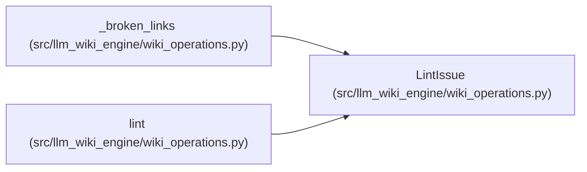

# LintIssue

**Location:** `src/llm_wiki_engine/wiki_operations.py:87`
**Kind:** Class
**Bases:** —
**Module:** [wiki_operations](../modules/wiki_operations.md)

**Decorators:** `@dataclass(frozen=True)`

## Description

_Auto-generated from `LintIssue` in `src/llm_wiki_engine/wiki_operations.py`._

## Attributes

| Name | Type | Default | Description |
|------|------|---------|-------------|
| `category` | `str` | *required* | — |
| `page` | `str` | *required* | — |
| `message` | `str` | *required* | — |

## Methods

*No declared methods.*

## Relationships

<!-- Auto-generated relationship summary. Do not edit by hand. -->

### Summary

| Module | Methods | Attributes |
|---|---:|---|
| [wiki_operations](../modules/wiki_operations.md) | 0 | `category`, `message`, `page` |

### References

| Reference | Kind | Source | Call sites |
|---|---|---|---:|
| `_broken_links` | call | [wiki_operations](../modules/wiki_operations.md) | 1 |
| `_broken_links` | type_reference | [wiki_operations](../modules/wiki_operations.md) | — |
| `lint` | call | [wiki_operations](../modules/wiki_operations.md) | 6 |
